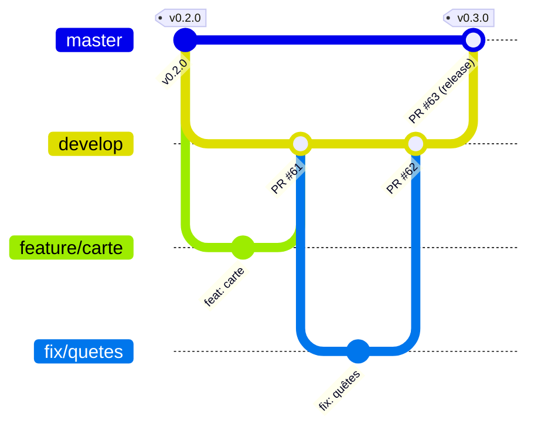

# Contribuer à Scubanion

Règles de travail de l'équipe Scubatana sur ce dépôt. Elles reprennent le § 6.5 du [cahier des charges](docs/cahier-des-charges.md) ; en cas de doute, c'est ce fichier qui décrit la pratique.

## Branches



| Branche | Rôle | Qui écrit dessus |
| ------- | ---- | ---------------- |
| `develop` | Branche d'intégration et branche par défaut : la prochaine version en préparation | Uniquement des PR depuis les branches de travail |
| `master` | La version livrée : chaque commit est une release taguée `vX.Y.Z` et déployée | Uniquement la PR de release `develop` → `master` |
| `feature/<sujet>`, `fix/<sujet>`, `docs/<sujet>`, `ci/<sujet>`, `build/<sujet>` | Une branche courte par tâche, créée depuis `develop` | Son auteur |

- **On ne fusionne jamais une branche de travail dans `master`.** Une PR qui vise `master` depuis une autre branche que `develop` est redirigée vers `develop` par `garde-des-pull-requests.yml`.
- Pas de push direct sur `develop` ni sur `master` (rulesets GitHub).
- Les PR sont fusionnées avec un **commit de merge** (ni squash ni rebase) : les commits de chacun et les numéros de PR restent visibles sur le miroir GitLab, où Git est noté.

## Une tâche, de bout en bout

```bash
git fetch origin
git switch -c feature/mon-sujet origin/develop
# ... commits ...
git push -u origin feature/mon-sujet
gh pr create --base develop --fill
```

1. La PR vise `develop` et suit le modèle proposé (résumé, exigences `APP-`, `PAS-`, `BOR-`, `BCK-` concernées, vérification).
2. La CI doit être verte : `Tests API` et `Tests app` sont obligatoires, `Tests API MariaDB` et `Tests borne` doivent passer aussi.
3. Un autre membre relit et approuve **le dernier push**. Tous les fils de revue sont résolus.
4. Si `develop` a avancé entre-temps, la garde le signale en commentaire et la fusion reste bloquée : l'auteur fusionne `develop` dans sa branche (`git fetch origin`, `git merge origin/develop`, `git push`). C'est voulu : le commit de merge est ainsi le sien, et il compte dans son historique Git sur GitLab IUT, alors qu'un commit fait par le bot ne compte pour personne.
5. L'auteur fusionne, la branche est supprimée.

## Release

1. Quand `develop` contient un ensemble cohérent (un jalon du planning, une démo), quelqu'un ouvre la PR `develop` → `master` : `gh pr create --base master --head develop --title "release: <résumé>"`.
2. Relecture et CI comme pour toute PR, puis fusion.
3. `release.yml` calcule le numéro depuis les Conventional Commits depuis le dernier tag (`feat` → mineure, le reste → correctif, `!` ou `BREAKING CHANGE:` → majeure à partir de 1.0.0), crée le tag `vX.Y.Z` et la release GitHub, avec les commits groupés par type et leur auteur.
4. Le miroir copie le tag sur GitLab IUT, dont le pipeline publie la release (site, APK signé, images DockerHub `vX.Y.Z`) et déploie sur le VPS.

Pour forcer un numéro (la `v1.0.0` du rendu, par exemple) : Actions → *Release* → *Run workflow* sur `master`, avec la version voulue.

## Commits

- [Conventional Commits](https://www.conventionalcommits.org/fr/), message en français : `feat: jauge de pas sur l'accueil`, `fix: …`, `test: …`, `docs: …`, `ci: …`, `build: …`.
- Des commits petits et réguliers. Chacun committe sous son vrai nom et l'email de son compte GitLab IUT (`git config user.name` et `git config user.email`), sinon ses commits ne lui sont pas attribués.

## Mise en place (une fois, par un administrateur)

Après la fusion dans `master` de la PR qui introduit ce flux : `bash .github/scripts/configurer-flux-develop.sh`. Le script crée `develop`, la protège, en fait la branche par défaut et redirige vers elle les PR ouvertes vers `master`.
