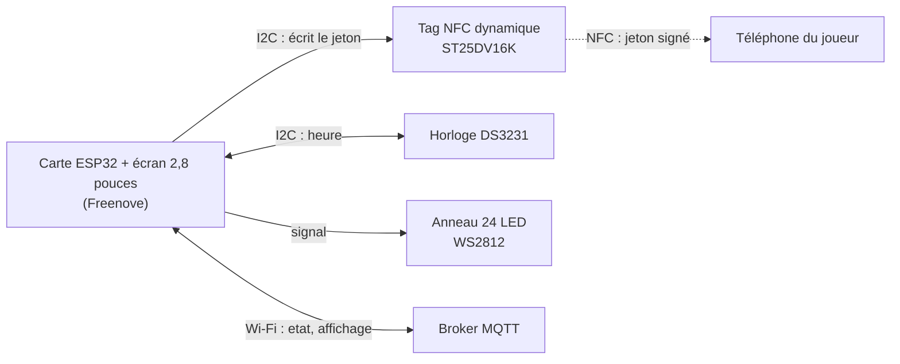
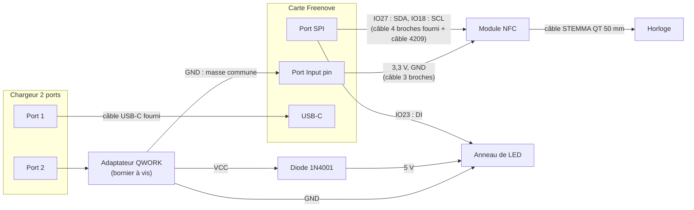

# Matériel des bornes

Ce document décrit le matériel d'une borne : les composants choisis et pourquoi, la commande, le branchement et les vérifications à faire à la réception (BOR-01, décision `D3` du [cahier des charges](cahier-des-charges.md)). Le protocole entre la borne et l'API (jeton, messages MQTT) est dans [mqtt.md](mqtt.md).

Prix et stocks relevés le 16/10/2026.

## En résumé

Une borne, c'est un **ESP32 avec écran tactile**, un **tag NFC dynamique** que le téléphone lit, une **horloge** qui garde l'heure sans réseau et un **anneau de LED** autour de la zone de scan.

À chaque scan, l'ESP32 calcule un jeton (voir [mqtt.md](mqtt.md)) et l'écrit dans la puce NFC, que le téléphone lit comme un tag ordinaire. L'anneau se remplit pendant le scan, et l'écran affiche la réponse du serveur reçue en MQTT.

## Choix des composants

### Microcontrôleur : ESP32 (décision `D3`)

| Option | Verdict |
| ------ | ------- |
| **ESP32** | **Retenu.** Wi-Fi intégré pour le MQTT (BOR-03), peu cher, sobre en énergie. Se programme avec le framework Arduino ou ESP-IDF. |
| Arduino Uno | Écarté : pas de réseau sans module, et pas assez de mémoire pour la bibliothèque NFC de ST. |
| Raspberry Pi | Écarté : plus cher, plus gourmand, un système Linux complet pour un besoin simple. |

La carte choisie est une **Freenove ESP32 avec écran tactile résistif de 2,8 pouces** (240 × 320, puce d'écran ST7789). L'écran affiche la récompense (BOR-04) et le tactile servira aux jeux et énigmes (BOR-06). Elle correspond à la carte « 2.8inch ESP32-32E » documentée sur [LCDwiki](https://www.lcdwiki.com/2.8inch_ESP32-32E-7789). Son **port SPI** expose quatre broches libres quand la carte microSD n'est pas utilisée : deux servent à l'I2C, une à l'anneau de LED.

### NFC : un tag dynamique, pas un lecteur

Avec `D2`, c'est le **téléphone qui lit la borne**. La borne doit donc se comporter comme un tag NFC dont le contenu change à chaque scan.

| Option | Verdict |
| ------ | ------- |
| **Tag NFC dynamique ST25DV** | **Retenu.** Une vraie puce de tag (ISO 15693, NFC Forum Type 5) que l'ESP32 réécrit en I2C. Le téléphone y voit un tag standard. La puce signale aussi la présence d'un téléphone (bit `FIELD_ON` du registre `EH_CTRL_Dyn`), ce qui déclenche l'animation. |
| Lecteur PN532 en émulation de tag | Écarté : fonctionne, mais fragile avec Android (émulation à relancer après chaque lecture, délais capricieux). |
| Lecteur RC522 | **Incompatible** : il ne sait que lire, il ne peut pas émuler un tag. C'est pourtant le lecteur des kits Arduino : ne pas le commander. |

Le module retenu est l'**Adafruit ST25DV16K** (réf. 4701), en STEMMA QT / Qwiic : il se branche sans soudure.

### Horloge : DS3231 Adafruit

Le jeton contient l'heure du scan, et l'API refuse un jeton de plus de 24 h ou daté de plus de 5 minutes dans le futur. L'horloge interne de l'ESP32 repart de zéro à chaque coupure de courant et ne retrouve l'heure que par NTP, donc avec du Wi-Fi. Sans horloge sauvegardée, une borne qui redémarre sans réseau produit des jetons tous refusés.

Le **DS3231** garde l'heure grâce à sa pile (précision d'environ une minute par an). Au démarrage, la borne lit l'heure dans le DS3231 ; dès que le Wi-Fi est là, elle la corrige par NTP. C'est ce qui permet le mode hors ligne (BOR-09).

Le module retenu est l'**Adafruit DS3231 Precision RTC** (réf. 5188), et non un module générique, pour deux raisons :

- les modules DS3231 génériques embarquent une mémoire AT24C32 à l'adresse I2C `0x57`, **la même que l'adresse système de la puce NFC**. Il faudrait un pont de soudure pour la déplacer ;
- leur circuit de recharge essaie de recharger une pile qui ne l'est pas.

### Anneau de LED : générique

Un anneau de 24 LED WS2812 entoure la zone de scan : il montre où poser le téléphone et se remplit pendant le scan. Un modèle générique suffit : la WS2812 est un composant standard, sans adresse ni pile, et une panne de l'anneau n'empêche pas la borne de valider les passages.

L'anneau est piloté directement par une broche de l'ESP32. Il est alimenté en 5 V **à travers une diode 1N4001** : la tension de l'anneau descend à environ 4,3 V, ce qui lui permet de comprendre le signal en 3,3 V de l'ESP32.

### Alimentation

Aucun connecteur de la carte ne fournit de 5 V. Un **chargeur USB à deux ports** alimente la carte d'un côté (câble USB-C fourni) et l'anneau de l'autre, par un **adaptateur USB vers bornier à vis**.

## Commande pour une borne

**Kiwi Electronics**

| # | Composant | Réf. | Qté | Prix | Lien |
| - | --------- | ---- | --- | ---- | ---- |
| 1 | Module NFC Adafruit ST25DV16K, STEMMA QT | Adafruit 4701 | 1 | 4,55 € | [lien](https://www.kiwi-electronics.com/en/adafruit-st25dv16k-i2c-rfid-eeprom-breakout-stemma-qt-qwiic-10409) |
| 2 | Horloge Adafruit DS3231 Precision RTC, STEMMA QT | Adafruit 5188 | 1 | 15,59 € | [lien](https://www.kiwi-electronics.com/en/adafruit-ds3231-precision-rtc-stemma-qt-20019) |
| 3 | Pile CR1220, pour l'horloge | CR1220 | 1 | 2,75 € | [lien](https://www.kiwi-electronics.com/en/cr1220-battery-750) |
| 4 | Câble STEMMA QT vers broches mâles, 150 mm | Adafruit 4209 | 1 | 1,14 € | [lien](https://www.kiwi-electronics.com/en/stemma-qt-qwiic-jst-sh-4-pin-to-premium-male-headers-cable-150mm-long-10386) |
| 5 | Câble STEMMA QT vers prises femelles, 150 mm (si le câble de la carte est mâle) | Adafruit 4397 | 1 | 1,14 € | [lien](https://www.kiwi-electronics.com/en/stemma-qt-qwiic-jst-sh-4-pin-cable-with-premium-female-sockets-150mm-long-10388) |
| 6 | Câble STEMMA QT court, 50 mm (NFC vers horloge) | Adafruit 4399 | 1 | 1,14 € | [lien](https://www.kiwi-electronics.com/en/stemma-qt-qwiic-jst-sh-4-pin-cable-50mm-long-10390) |
| 7 | Diodes 1N4001, lot de 10 | 1N4001 | 1 lot | 1,19 € | [lien](https://www.kiwi-electronics.com/en/1n4001-diode-10-pack-395) |
| 8 | Fils Dupont, 40 fils mâle/mâle, 20 cm | Premium Jumperwires | 1 lot | 2,99 € | [lien](https://www.kiwi-electronics.com/en/premium-jumperwires-ribbon-40-wires-m-m-20cm-363) |
| 9 | Fils Dupont, 40 fils mâle/femelle, 20 cm | Premium Jumperwires | 1 lot | 2,99 € | [lien](https://www.kiwi-electronics.com/en/premium-jumperwires-ribbon-40-wires-m-f-20cm-364) |

Total : 33,48 €, plus les frais de port (à partir de 7,19 €).

**Amazon**

| # | Composant | Réf. | Qté | Prix | Lien |
| - | --------- | ---- | --- | ---- | ---- |
| 10 | Carte Freenove ESP32, écran tactile 2,8" (câble USB-C et câble 4 broches fournis) | B0GVXBDFXV | 1 | 17,95 € | [lien](https://www.amazon.fr/dp/B0GVXBDFXV) |
| 11 | Anneau LED Tyenaza, 24 LED WS2812, 65 mm | B09V2T6WQ6 | 1 | 7,99 € | [lien](https://www.amazon.fr/dp/B09V2T6WQ6) |
| 12 | Chargeur secteur USB 2 ports, 12 W (5 V, 2,4 A) | B0DQPPV3YQ | 1 | 7,98 € | [lien](https://www.amazon.fr/dp/B0DQPPV3YQ) |
| 13 | QWORK, adaptateur USB-A vers bornier à vis (lot mâle et femelle) | B09RDVKPFJ | 1 lot | 6,98 € | [lien](https://www.amazon.fr/dp/B09RDVKPFJ) |

**Pour une deuxième borne**, reprendre une fois les lignes 1 à 6 et 10 à 12. Les lignes 7 à 9 et 13 sont des lots qui suffisent pour deux bornes (seul l'adaptateur QWORK mâle sert).

**Déjà disponible** : fer à souder, étain et multimètre au FabLab.

### À acheter après la réception de la carte

Un **câble 1,25 mm à 3 broches** pour le port « Input pin » de la carte (GND, 3,3 V, IO35), du même type de connecteur que le câble 4 broches fourni : les annonces « 1,25 mm » mélangent le MX1.25 (compatible Molex PicoBlade) et le JST GH, de même pas mais de forme différente. L'autre extrémité peut être une prise Dupont femelle ou des fils nus, à souder sur le module NFC.

## Brochage de la carte

D'après la [fiche technique LCDwiki](https://www.lcdwiki.com/res/E32R28T-1/E32R28T-1_E32N28T-1_Specification_V1.0.pdf). Tous les connecteurs sont au pas de 1,25 mm. **À confirmer avec le tutoriel Freenove** à la réception.

| Port | Broches | Usage dans la borne |
| ---- | ------- | ------------------- |
| SPI (4 broches) | IO27, IO18, IO19, IO23, partagées avec la microSD | IO27 : SDA · IO18 : SCL · IO23 : anneau de LED · IO19 : libre |
| Input pin | GND, 3,3 V, IO35 (entrée seulement) | 3,3 V et GND des modules I2C |
| Serial | RX (IO3), TX (IO1) | non utilisé |
| USB-C | 5 V | alimentation et programmation |

La microSD ne doit pas être utilisée : elle partage les broches du port SPI. Le rétroéclairage de l'écran est sur IO21.

### Adresses I2C

| Module | Adresses |
| ------ | -------- |
| ST25DV (NFC) | `0x53` (mémoire utilisateur), `0x57` (mémoire système) |
| DS3231 (horloge) | `0x68` |

Aucun conflit. Ne pas ajouter de module DS3231 générique sans déplacer l'adresse de sa mémoire (voir plus haut).

## Montage

Fil par fil :

| De | Vers | Remarque |
| -- | ---- | -------- |
| Port SPI, IO27 | SDA de la chaîne I2C (fil bleu du câble 4209) | |
| Port SPI, IO18 | SCL de la chaîne I2C (fil jaune) | |
| Port Input pin, 3,3 V | 3,3 V de la chaîne I2C (fil rouge) | |
| Port Input pin, GND | GND de la chaîne I2C (fil noir) | |
| Module NFC | Horloge | câble STEMMA QT 50 mm |
| Port SPI, IO23 | Anneau, pastille DI (ou DIN, IN) | |
| QWORK, borne VCC | Diode, patte **sans** anneau gris | la patte se serre directement dans le bornier |
| Diode, patte **avec** anneau gris | Anneau, pastille 5V | soudure |
| QWORK, borne GND | Anneau, pastille GND | soudure côté anneau |
| QWORK, borne GND | GND de la carte | **masse commune** : sans elle, l'anneau ne comprend pas le signal |

La pastille DO (ou DOUT, OUT) de l'anneau ne sert pas : elle chaîne un autre anneau. Les bornes D-, D+ et blindage du QWORK ne servent pas non plus.

Les couleurs des câbles STEMMA QT suivent la convention Qwiic : noir GND, rouge 3,3 V, bleu SDA, jaune SCL. Celles du câble fourni avec la carte ne suivent pas forcément une convention : **vérifier chaque fil avec le brochage avant de brancher**.

### À souder

| Soudure | Difficulté |
| ------- | ---------- |
| 3 fils sur les pastilles de l'anneau (5V, GND, DI) | Facile |
| Fil du 5 V sur la patte de la diode | Facile |
| Si le câble 3 broches a des fils nus : 3,3 V et GND sur les pastilles du module NFC | Facile |

Rien n'est soudé sur la carte ESP32.

## Alimentation et installation

| Élément | Consommation estimée |
| ------- | -------------------- |
| Carte (ESP32 avec Wi-Fi, écran) | 0,3 à 0,5 A |
| Anneau, luminosité bridée dans le code | 0,2 à 0,4 A |
| Modules NFC et horloge | quelques mA |

Le tout reste sous 1 A, pour 2,4 A disponibles.

Le chargeur reste **près de la borne** (dans la boîte ou fixé derrière) et une **rallonge secteur** va jusqu'à la prise. Ne pas laisser le chargeur au sol avec de longs câbles USB : la tension chute et l'ESP32 et les LED deviennent instables. Dans la boîte, laisser un peu d'air autour du chargeur et une encoche pour le câble de la rallonge.

Pour une démonstration, le Wi-Fi de l'IUT (eduroam, WPA2-Entreprise) est mal géré par l'ESP32 : utiliser un partage de connexion depuis un téléphone, **en 2,4 GHz** (l'ESP32 ne capte pas le 5 GHz).

## Boîtier

Découpe laser dans du bois de 3 mm par l'IUT ou potentiel accès au FabLab.

- **Le NFC passe à travers 3 mm de bois**, pas à travers le métal. Coller le module contre la face intérieure, sans espace d'air, au centre de l'anneau.
- **L'anneau ne doit pas recouvrir le module NFC** : son circuit en cuivre gênerait l'antenne.
- Une fente en forme d'anneau laisse passer la lumière. **Garder 3 ou 4 ponts** dans la découpe, sinon le disque central tombe. Un papier calque ou un plexiglas dépoli derrière la fente donne un halo continu au lieu de 24 points.
- Prévoir la fenêtre de l'écran, l'accès au port USB-C pour reprogrammer la carte et une zone « pose ton téléphone ici » bien visible.

## Vérifications à la réception

- [ ] **Brochage de la carte** : confirmer dans le tutoriel Freenove les broches des ports SPI et Input pin.
- [ ] **Câble 4 broches fourni** : prises femelles (câble 4209) ou mâles (câble 4397) au bout ? Commander le câble 3 broches du même type.
- [ ] **Anneau** : compter 24 LED, repérer les pastilles 5V, GND et DI.
- [ ] **Chargeur** : logo CE.
- [ ] **Bornier QWORK** : au multimètre, environ 5 V entre VCC et GND, chargeur branché, puis environ 4,3 V après la diode. C'est cette mesure qui identifie les bornes si les marquages sont illisibles.
- [ ] **Pile CR1220** en place dans l'horloge.
