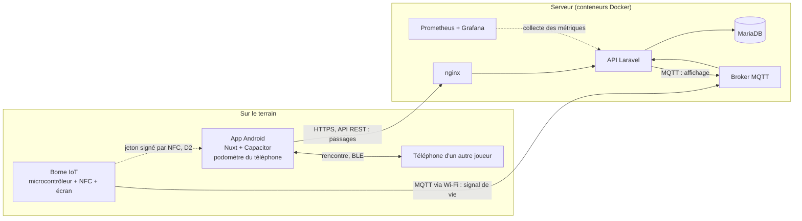
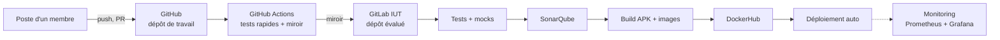

# Cahier des charges - Scubanion

- **Projet** : Scubanion · **Équipe** : Scubatana · Projet BUT3-IoT (IUT)
- **Membres** : BANDIERAS Thomas · DALMASSO Evan · KARROUCHI Hamza · LESUEUR Shaleena
- **Version** : 0.8 du 14/10/2026
- **Sources** : cours R5.07, programme de R5.04, consignes de R5.01, notes de l'équipe, README et maquettes du dépôt

Ce document résume le projet et les règles à respecter. C'est notre référence commune et notre liste de suivi : on coche au fil de l'avancement, et chaque décision met le document à jour (par PR, comme le code). Les éléments marqués *proposition* sont à valider en équipe.

**Légende** : **Must** = indispensable au rendu · **Should** = prévu · **Could** = bonus si le temps le permet · `D1` à `D10` = décisions à prendre (§ 8).

---

## 1. Le projet en bref

- **Sujet imposé** : « Le projet BUT3-IoT porte sur l'exploration des adaptations possibles de l'être humain à son environnement grâce à l'IoT. »
- **Notre problématique** : comment réadapter l'homme à son environnement ?
- **Problème ciblé** : la sédentarité et l'isolement social.
- **Cible** : étudiants et jeunes actifs connectés.
- **Notre réponse** : un compagnon virtuel, façon Tamagotchi, qui ne grandit que si son propriétaire sort. *« Il ne grandit que si toi tu sors. »*

Comment ça marche :

1. Le **podomètre du téléphone** compte les pas du joueur, sans matériel supplémentaire : ils font gagner de l'XP à son compagnon.
2. Des **quêtes géolocalisées** l'envoient vers des lieux réels : parcs, points d'intérêt.
3. Quand deux joueurs **se croisent physiquement** (détection BLE entre téléphones, recoupée par la géolocalisation côté serveur), leurs compagnons gagnent un bonus.
4. Des **bornes IoT** (lecteur NFC + écran), installées dans des lieux publics ou chez des partenaires, débloquent skins, récompenses, événements, jeux et énigmes. Exemple de collab : une borne au Decathlon de Châtelet-les-Halles qui débloque un skin exclusif.

## 2. Charte de projet

> **La charte complète est dans [docs/r501/](r501/)**, au format attendu par le cours de R5.01 :
> cadrage, périmètre et contraintes, pilotage, puis l'analyse des risques.
> Cette section-ci en est la partie opérationnelle, celle qu'on tient à jour chaque semaine :
> les objectifs, les indicateurs et le plan d'action. Les deux doivent rester cohérentes.

Cette section est notre engagement commun : ce que le projet doit atteindre (§ 2.1), comment on mesure si on y va (§ 2.2) et qui fait quoi jusqu'à la soutenance (§ 2.3). Elle se relit à chaque jalon du § 9 et se met à jour comme le reste du document, par PR.

### 2.1 Objectifs SMART

**O1 - Produit.** Livrer au **12/12/2026** une application Android et une borne IoT fonctionnelles couvrant les **18 exigences *Must*** du § 5, et en faire la démonstration en direct le 13/01/2027.

| Critère | Comment il est tenu |
| --------- | ------------------- |
| Spécifique | Périmètre fermé : les 18 exigences *Must* (6 `APP-`, 2 `PAS-`, 6 `BOR-`, 4 `BCK-`). Les *Should* et *Could* sont hors objectif. |
| Mesurable | Cases *Must* cochées au § 5, sur 18. Démonstration réussie = les trois briques (téléphone → serveur → borne) enchaînées sans intervention manuelle. |
| Atteignable | 11 semaines à 4 personnes. Les *Should* et *Could* servent de variable d'ajustement ; gel des fonctionnalités le 05/12. |
| Réaliste | C'est le livrable noté de la SAE et le support de la soutenance. |
| Temporel | Rendu le 12/12/2026, démonstration le 13/01/2027. |

**O2 - Industrialisation.** Mettre en service au **08/11/2026** un pipeline GitLab CI qui, à chaque fusion sur `master`, enchaîne tests → SonarQube → build → publication DockerHub → déploiement automatique, avec une couverture de tests d'au moins **60 %** et **aucun bug bloquant** SonarQube.

| Critère | Comment il est tenu |
| --------- | ------------------- |
| Spécifique | Les cinq étapes nommées, sur le dépôt GitLab IUT, déclenchées par la fusion sur `master`. |
| Mesurable | Pipeline vert de bout en bout ; couverture ≥ 60 % ; 0 bug bloquant ; 0 adresse IP et 0 secret en dur. |
| Atteignable | Les commandes de test existent déjà (`composer test`) ; chaque membre porte une étape du pipeline (§ 7). |
| Réaliste | Exigence explicite de R5.07, et elle est notée (§ 6.2). |
| Temporel | 08/11/2026, fin du jalon J2. |

**O3 - Validation terrain.** Valider le modèle économique avant le **29/11/2026** avec **2 partenaires parisiens** signataires d'une lettre d'intention et **20 testeurs** du campus ayant utilisé l'app pendant au moins 7 jours.

*Cible revue à la baisse le 13/10* : elle était de 3 partenaires et 30 testeurs. Le point d'avancement du 13/10 montre que la borne, qui est le chemin critique, n'est pas commencée ; tenir 3 signatures en six semaines tout en la construisant n'était pas réaliste.

| Critère | Comment il est tenu |
| --------- | ------------------- |
| Spécifique | 2 lettres d'intention couvrant 2 segments distincts parmi : une collectivité ou un office de tourisme, un lieu à billetterie, un commerce de proximité. Et 20 testeurs identifiés. |
| Mesurable | Nombre de lettres signées ; nombre de testeurs actifs au moins 7 jours ; grille tarifaire du Business Model Canvas confrontée en rendez-vous. |
| Atteignable | Le campus fournit le vivier de testeurs. 7 semaines pour 2 signatures, soit une dizaine de rendez-vous à provoquer. |
| Réaliste | Répond aux attentes de R5.01 et R5.13, et lève les hypothèses non validées du Business Model Canvas ([docs/bmc-reponses-relecture.md](bmc-reponses-relecture.md)). |
| Temporel | 29/11/2026, fin du jalon J3. |

### 2.2 Indicateurs de suivi

| # | Indicateur | Mesure | Cible | Fréquence |
| - | ---------- | ------ | ----- | ---------- |
| K1 | Avancement du périmètre *Must* | Cases *Must* cochées au § 5, divisées par 18 | 100 % au 05/12 ; au moins 50 % au 08/11 | Hebdomadaire |
| K2 | Santé du pipeline | Part de pipelines verts sur `master` sur 7 jours, et durée médiane d'exécution | ≥ 90 % de verts, durée < 10 min | Hebdomadaire |
| K3 | Qualité du code | Couverture de tests et nombre de bugs bloquants ou critiques dans SonarQube | ≥ 60 % de couverture, 0 bloquant | À chaque pipeline, relevé le vendredi |
| K4 | Équilibre des contributions | Commits et revues de PR par membre sur 7 jours | Chacun : ≥ 5 commits et ≥ 2 revues | Hebdomadaire |
| K5 | Fiabilité du passage en borne | Part de passages NFC réussis sur une série de 20 essais, du téléphone jusqu'à la récompense affichée | ≥ 95 % au 29/11 | Hebdomadaire, dès que le prototype existe |
| K6 | **Rétention à 30 jours** | Part des joueurs encore actifs 30 jours après leur inscription, par cohorte | ≥ 25 % | Mensuelle, dès le pilote |
| K7 | **Lieux partenaires et revenu récurrent** | Nombre de lieux sous contrat facturé, et revenu mensuel | 2 lieux payants au 30/06/2027, puis 40 lieux et 5 000 €/mois | Mensuelle |

**K6 et K7 sont les indicateurs d'entreprise** : K1 à K5 disent si on livre, K6 et K7 disent si le produit trouve son marché. K6 est le plus important des sept — si la rétention ne tient pas, il n'y a plus d'audience à vendre aux lieux, et le modèle économique s'effondre. Le détail de ces deux indicateurs, et la décision que chacun déclenche, sont dans la charte de projet ([r501/charte-de-projet.pdf](r501/charte-de-projet.pdf), § 6).

K4 existe parce que **Git est noté individuellement** (§ 6.5) : un membre qui ne committe pas est pénalisé même si l'équipe livre. Les indicateurs se relèvent en début de réunion hebdomadaire. Un indicateur hors cible **deux semaines de suite** déclenche un arbitrage : réduction du périmètre *Should* et *Could*, ou réaffectation d'un lot.

**Relevé du 14/10/2026**

| Indicateur | Valeur | État |
| ---------- | ------ | ---- |
| K1 Avancement *Must* | 5 / 18, soit 28 % | En cours. 8 PR ouvertes couvriraient 9 exigences de plus. |
| K2 Santé du pipeline | - | Pipeline pas encore en service (échéance 08/11). |
| K3 Qualité du code | - | Couverture pas encore mesurée. |
| K4 Contributions | 47 / 13 / 1 / 0 commits | **Hors cible.** C'est notre premier sujet : voir le risque R1 de la charte. |
| K5 Passage en borne | - | Prototype pas encore monté (échéance 14/11). |
| K6 Rétention à 30 jours | - | Aucun joueur hors équipe à ce jour. Première mesure au pilote. |
| K7 Lieux et revenu | 0 lieu, 0 € | Aucun rendez-vous partenaire tenu. C'est l'action A2 de la charte. |

### 2.3 Plan d'action du 13/10/2026 au 13/01/2027

Dix actions, chacune avec un responsable nommé et une échéance. Elles découlent du point
d'avancement du 13/10 : le logiciel avance vite, **la borne n'est pas commencée** et porte
6 exigences *Must* sur 18. C'est elle qui ordonne le plan.

| #   | Action                                                                                                                                              | Livrable vérifiable                                                     | Responsable      | Échéance       | Obj.   |
| --- | --------------------------------------------------------------------------------------------------------------------------------------------------- | ------------------------------------------------------------------------ | ---------------- | --------------- | ------ |
| A1  | Trancher `D3` (microcontrôleur), dont dépend le moyen matériel de `D2` (tranchée le 13/10), et **commander le matériel le jour même**                | Décision écrite au § 8, bon de commande, délai de livraison connu       | LESUEUR Shaleena | **17/10**       | O1     |
| A2  | Fusionner les 8 demandes de fusion ouvertes après revue croisée, et cocher les exigences correspondantes                                             | `master` à 14 exigences *Must* sur 18, tag `v0.2.0`                     | KARROUCHI Hamza  | 24/10           | O1     |
| A3  | Pipeline GitLab complet : tests avec mocks, SonarQube, build, publication DockerHub, déploiement automatique                                         | Un pipeline vert de bout en bout sur une fusion dans`master`            | BANDIERAS Thomas | **08/11**     | O2     |
| A4  | Prototype de borne sur table : lecture NFC, publication MQTT, passage enregistré par le serveur (`BOR-02`, `BOR-03`)                                | Un passage de bout en bout filmé, visible dans la base                   | LESUEUR Shaleena | 14/11           | O1     |
| A5  | Consentements RGPD et suppression du compte dans l'application (`APP-06`)                                                                            | Parcours de consentement et suppression effective, testés                | DALMASSO Evan    | 14/11           | O1     |
| A6  | Démarcher les partenaires et recruter les testeurs : 10 rendez-vous visés pour 2 lettres d'intention, et 20 testeurs sur le campus                   | 2 lettres signées, 20 comptes actifs depuis 7 jours au moins             | DALMASSO Evan    | **29/11**     | O3     |
| A7  | Compagnon animé et quêtes côté application (`APP-03`, `APP-05`)                                                                                     | Niveau, humeur et santé qui évoluent ; une quête menée de bout en bout | DALMASSO Evan    | 21/11           | O1     |
| A8  | Récompense affichée en borne et monitoring : écran, inventaire, signal de vie remonté (`BOR-04`, `BOR-08`)                                         | Récompense visible à l'écran et dans l'inventaire ; bornes monitorées  | BANDIERAS Thomas | 29/11           | O1     |
| A9  | Mode hors ligne de la borne et campagne de tests : mocks MQTT et NFC, couverture portée à 60 % (`BOR-09`)                                           | Couverture ≥ 60 % et zéro bug bloquant dans SonarQube                   | KARROUCHI Hamza  | **05/12**     | O1 O2  |
| A10 | Gel, rendu et répétition : tag `v1.0.0`, documentation complète, trois répétitions chronométrées de la démonstration                                | Dépôt GitLab rendu le 12/12 ; démonstration tenue en moins de 10 minutes | Toute l'équipe   | **12/12**     | O1     |

**Jalons**

| Période            | Jalon            | Contenu                                                                                                              | *Must* visées |
| ------------------- | ---------------- | -------------------------------------------------------------------------------------------------------------------- | --------------- |
| 13 → 31 octobre    | `v0.2.0`       | Matériel commandé (**A1**), demandes de fusion intégrées (**A2**), pipeline amorcé                              | 14 / 18         |
| 1 → 30 novembre    | `v0.3.0`       | Pipeline complet (**A3**), borne qui lit et publie (**A4**), RGPD (**A5**), compagnon et quêtes (**A7**), récompense et monitoring (**A8**), terrain (**A6**) | 17 / 18         |
| 1 → 12 décembre    | `v1.0.0`       | Hors ligne et tests (**A9**),**gel le 05/12**, documentation,**rendu le 12/12** (**A10**)                 | 18 / 18         |
| 13 déc. → 13 janv. | Soutenance       | Répétitions chronométrées, support de présentation, démonstration en direct le 13/01                            | -              |

**Règles de suivi.** Point d'équipe chaque vendredi : chaque responsable dit *fait / en cours / bloqué*.
Une action non terminée est reportée **avec sa cause écrite**, jamais effacée. Toute action nouvelle
entre dans ce tableau avec un responsable et une échéance, sinon elle n'existe pas.

**Les actions du 09 au 23/10 sont closes.** Elles portaient sur le cadrage et les fondations
(décisions `D1`, identité Git, modèle de données, authentification, socle de l'app). Ce qui n'a pas
abouti est repris ci-dessus : `D3` dans **A1** (`D2` a été tranchée le 13/10), le pipeline dans **A3**.

## 3. Calendrier et livrables

| Échéance      | Date                                       | Contenu                                                       |
| --------------- | ------------------------------------------ | ------------------------------------------------------------- |
| Rendu           | **samedi 12/12/2026**                | Dépôt GitLab IUT + documentation                            |
| Soutenance      | **mercredi 13/01/2027**, après-midi | Présentation et démo                                        |
| Contrôle R5.07 | à confirmer                               | Écrit individuel de 60 min sur le cours, avec un peu de code |

Jalons intermédiaires : § 9.

## 4. Architecture

| Brique                | Techno                                                   | Pourquoi                                                                                                | État            |
| --------------------- | -------------------------------------------------------- | ------------------------------------------------------------------------------------------------------- | ---------------- |
| App mobile            | Nuxt 4, Vue 3, TypeScript, Capacitor 8 (Android)         | Une seule base web, accès natif au BLE et au podomètre par plugin                                                      | Connexion, profil, compagnon, pas |
| Borne                 | ESP32, Arduino ou Raspberry Pi + lecteur NFC + écran    | Vrai système cyber-physique, programmé par l'équipe                                                  | À choisir (D3)  |
| API                   | PHP 8.4, Laravel 13                                      | ORM, migrations, authentification et tests intégrés                                                   | Connexion, profil, compagnon, pas |
| Base de données      | MariaDB 11.4                                             | Données très relationnelles (amitiés, inventaires, passages) : un SGBD plutôt que des fichiers JSON | Joueurs, compagnons, pas |
| Messagerie IoT        | MQTT (broker type Mosquitto)                             | Pub/sub léger, fait pour les objets contraints (vu en R5.04)                                           | À faire         |
| Flux d'événements   | Kafka                                                    | Découpler la réception des événements des règles de jeu, pouvoir les rejouer (vu en R5.04)         | À évaluer (D5) |
| Standard IoT          | oneM2M                                                   | Décrire les bornes selon un standard (vu en R5.04)                                                     | À évaluer (D5) |
| Reverse proxy         | nginx                                                    | Point d'entrée HTTP unique                                                                             | Conteneur prêt  |
| Admin BDD             | phpMyAdmin                                               | En développement uniquement                                                                            | Conteneur prêt  |
| CI/CD                 | GitLab CI (runner Docker du VPS), GitHub Actions         | Dépôt de travail sur GitHub, miroir évalué sur GitLab IUT (§ 6.5)                                  | GitLab CI en place sur `master`, GitHub Actions à faire |
| Qualité              | SonarQube                                                | Exigé par R5.07                                                                                        | À faire (D7)    |
| Registre d'images     | DockerHub                                                | Exigé par R5.07                                                                                        | Job prêt, attend les accès |
| Hébergement          | Azure ou autre, hôte configuré par Ansible (optionnel) | Exigé par R5.07                                                                                        | À choisir (D6)  |
| Monitoring            | Prometheus + Grafana (+ Alertmanager)                    | Pile vue en R5.07                                                                                       | À faire         |
| Passage à l'échelle | Docker Swarm (réplicas de l'API)                        | Bonus R5.07                                                                                             | Bonus            |

## 5. Exigences fonctionnelles

### 5.1 App mobile (Android)

- [x] **APP-01** · Must : Inscription et connexion par email et code à usage unique (D1).
- [x] **APP-02** · Must : Profil : pseudo, date de naissance, genre (facultatif), ambition (retrouver la forme, sortir plus souvent, rencontrer du monde, explorer son quartier). L'ambition oriente les quêtes et les objets débloqués.
- [ ] **APP-03** · Must : Compagnon animé : niveau, XP et état (humeur, santé) qui évoluent avec l'activité réelle.
- [x] **APP-04** · Must : Objectif de pas du jour (5 000 par défaut) et compteur en direct.
- [ ] **APP-05** · Must : Quêtes : quiz, photos de sortie, nouveaux lieux, rencontres, défi de la semaine.
- [ ] **APP-06** · Must : Consentements explicites (localisation, Bluetooth, activité) et suppression du compte (RGPD, § 6.5).
- [ ] **APP-07** · Should : Amis : liste, invitation par code, activité des amis.
- [ ] **APP-08** · Should : Rencontres : deux joueurs qui se croisent gagnent un bonus (BLE entre téléphones, recoupé par la géolocalisation côté serveur).
- [ ] **APP-09** · Should : Carte : lieux, bornes et quêtes à proximité, recherche.
- [ ] **APP-10** · Could : Équipes : marcher ensemble fait grandir les deux compagnons plus vite.
- [ ] **APP-11** · Could : Chat entre amis et en équipe.
- [ ] **APP-12** · Could : Notifications (« passe au parc avant 20 h pour une quête bonus »).

### 5.2 Pas (podomètre du téléphone)

- [x] **PAS-01** · Must : Lecture des pas par le capteur de pas Android (`STEP_COUNTER`), avec permission explicite et rattrapage après un redémarrage ou une app fermée.
- [x] **PAS-02** · Must : Envoi des pas au serveur, avec une file d'attente locale quand le réseau coupe.
- [ ] **PAS-03** · Could : Lecture via Health Connect, pour les joueurs qui ont déjà une montre ou un bracelet branché à leur téléphone.

### 5.3 Borne IoT

- [ ] **BOR-01** · Must : Matériel choisi et justifié : microcontrôleur, lecteur NFC, écran (D3).
- [ ] **BOR-02** · Must : Passage prouvé par NFC (D2) : la borne transmet au téléphone un jeton signé avec son propre secret, horodaté et à usage unique. Le joueur est identifié par sa session dans l'app : aucun identifiant de joueur ne passe par la borne.
- [ ] **BOR-03** · Must : Communication avec le serveur en MQTT, via Wi-Fi : signal de vie de la borne, et réponse du serveur à afficher après chaque passage.
- [ ] **BOR-04** · Must : Récompense au passage (skin, objet ou XP), affichée à l'écran et ajoutée à l'inventaire du joueur.
- [ ] **BOR-05** · Should : Événements limités dans le temps (bonus d'un week-end, skin de saison).
- [ ] **BOR-06** · Should : Jeux et énigmes à résoudre sur la borne.
- [ ] **BOR-07** · Should : Collabs : une borne chez un partenaire débloque un contenu exclusif (ex. Decathlon Châtelet-les-Halles).
- [ ] **BOR-08** · Must : Signal de vie envoyé au serveur, visible dans le monitoring.
- [ ] **BOR-09** · Must : Mode hors ligne : la borne fonctionne sans réseau (le jeton ne demande que son horloge, tenue à l'heure par NTP), et le téléphone garde le jeton puis l'envoie au serveur dans les 24 h.

Passage à une borne : la borne donne un jeton signé au téléphone par NFC, le téléphone l'envoie à l'API (`POST /api/me/passages`), l'API le vérifie et répond à la borne par MQTT. Le protocole complet (format du jeton, messages) est dans [mqtt.md](mqtt.md).

Topics MQTT :

| Topic                               | Sens             | Contenu                                                           |
| ----------------------------------- | ---------------- | ----------------------------------------------------------------- |
| `scubanion/bornes/{id}/affichage` | serveur → borne | Ce que l'écran doit montrer après un passage (récompense, déjà passé) |
| `scubanion/bornes/{id}/etat`      | borne → serveur | Signal de vie ; un *Last Will* MQTT signale une borne hors ligne |

### 5.4 Back-end, données et web

- [ ] **BCK-01** · Must : API REST pour l'app : authentification par jeton, joueur, compagnon, pas, quêtes, amis.
- [ ] **BCK-02** · Must : Base MariaDB : infos joueur, amitiés, compagnon, et le reste du modèle ci-dessous.
- [ ] **BCK-03** · Must : Règles de jeu calculées côté serveur (XP, niveaux, validation des quêtes et des passages), avec des garde-fous simples contre la triche (plafond de pas par heure, cohérence des positions).
- [x] **BCK-04** · Must : Abonné MQTT qui suit le signal de vie des bornes ; le serveur vérifie chaque passage (jeton signé, à usage unique) et répond à la borne par MQTT.
- [ ] **BCK-05** · Should : Kafka pour le flux d'événements (pas, passages, rencontres), si l'intérêt est démontré (D5).
- [ ] **BCK-06** · Could : Ressources oneM2M pour décrire les bornes (D5).
- [ ] **BCK-07** · Could : Application web de consultation (compagnon, historique, quêtes), construite à partir des maquettes de `scubatana.demo`.
- [ ] **BCK-08** · Could : Back-office pour créer quêtes, événements, skins et partenaires.

Modèle de données (v0, à affiner). Les tables déjà créées sont décrites dans [modele-de-donnees.md](modele-de-donnees.md) :

| Entité                 | Contenu principal                                                                                                      |
| ----------------------- | ---------------------------------------------------------------------------------------------------------------------- |
| Joueur                  | Pseudo, contact (email, D1), date de naissance, genre (facultatif), ambition, consentements        |
| Compagnon               | Joueur, nom, espèce, niveau, XP, humeur et santé, skin porté. Le volet « relation, login » reste à définir (D4) |
| Amitié                 | Deux joueurs, statut (en attente, acceptée), date                                                                     |
| Activité               | Joueur, jour, nombre de pas, source (téléphone, Health Connect)                                                            |
| Quête, progression     | Type, objectif, récompense ; avancement de chaque joueur                                                              |
| Lieu                    | Nom, coordonnées, type (parc, point d'intérêt, partenaire)                                                          |
| Borne, passage          | Lieu, partenaire éventuel, état, dernier signal ; passages (joueur, borne, date, récompense)                        |
| Récompense, inventaire | Type (skin, objet, XP), origine (quête, borne, événement, collab) ; objets possédés par chaque joueur             |
| Événement             | Période, bornes concernées, récompense                                                                              |
| Partenaire              | Nom, bornes, contenus exclusifs                                                                                        |
| Rencontre               | Deux joueurs, date, zone approximative, validée ou non                                                                |
| Équipe, message        | Seulement si APP-10 et APP-11 sont faits                                                                               |

## 6. Règles à respecter

### 6.1 Consignes communes

- [ ] Le projet est commun à **R5.01** (management d'une équipe de projet), **R5.13** (économie durable et numérique), **R5.04** (programmation avancée) et **R5.07** (automatisation de la chaîne de production).
- [ ] Les technologies sont libres, mais **chaque choix est motivé** et l'architecture est adaptée (exemple du cours : base de données ou fichier JSON). L'équipe se débrouille seule sur les technos qu'elle a choisies.
- [ ] Rendu : dépôt GitLab IUT + documentation, le 12/12. Soutenance le 13/01 après-midi.

La lettre de commande et les consignes détaillées de R5.01, R5.13 et R5.04 n'ont pas été communiquées : **à compléter dès réception**.

### 6.2 R5.07 - Automatisation de la chaîne de production

Évaluation : dépôt (coeff. 1) + soutenance (coeff. 1) + contrôle écrit individuel de 60 min (coeff. 1). La documentation fait partie du rendu. **Tous les membres doivent contribuer au pipeline.**

Pipeline de déploiement continu exigé :

- [ ] 1. Lancer automatiquement les tests unitaires.
- [ ] 2. Construire l'application.
- [ ] 3. Publier les résultats sur un SonarQube.
- [ ] 4. Publier les images Docker sur DockerHub.
- [x] 5. Pouvoir lancer l'application avec un fichier docker-compose.
- [ ] 6. Déployer automatiquement sur Azure ou ailleurs (Ansible possible pour configurer l'hôte).
- [ ] 7. *Bonus* : faire passer à l'échelle les services qui en ont besoin.
- [ ] 8. Mettre en place une pile de monitoring.
- [ ] Stratégie Git définie et documentée.
- [ ] Déclencheurs du pipeline définis et documentés.
- [ ] Documentation qui accompagne le pipeline.

Grille d'évaluation, à relire avant le rendu :

- **Fonctionnement et documentation**
  - [ ] Le pipeline fonctionne de bout en bout.
  - [ ] La documentation est claire et explique les choix de conception.
- **Git** (sur GitLab IUT, noté pour chaque étudiant)
  - [ ] La stratégie d'utilisation du dépôt est respectée.
  - [ ] Chacun des 4 membres fait des commits réguliers et bien documentés.
- **Tests**
  - [ ] Les tests sont de qualité.
  - [ ] Mocks et autres types de tests (fonctionnels, intégration).
- **Construction**
  - [ ] Dépendances bien gérées, conception modulaire.
  - [ ] Images Docker de qualité : taille réduite, pas d'IP en dur.
  - [ ] Rapports SonarQube au vert.
- **Déploiement**
  - [ ] docker-compose de qualité (pas d'IP en dur, réseaux) et fichiers Ansible.
  - [ ] Mécanisme de passage à l'échelle expliqué, s'il est mis en place.
  - [ ] Mécanisme de monitoring expliqué.

### 6.3 R5.04 - Programmation avancée (IoT)

Consigne : « Vous utiliserez ce que nous avons vu en cours. Votre code sera évalué. »

Programme : systèmes IoT et cyber-physiques (CPS) · supports de communication et échange de données · standards pour l'IoT · frameworks de développement et de déploiement IoT. Vus à ce jour : MQTT, Kafka, oneM2M (liste à compléter au fil du cours).

| Thème du cours                                 | Dans Scubanion                                                                                                                 |
| ----------------------------------------------- | ------------------------------------------------------------------------------------------------------------------------------ |
| Systèmes cyber-physiques                       | La borne : un geste physique (approcher son téléphone de la borne, en NFC) déclenche un effet dans le jeu. Le podomètre du téléphone mesure l'activité réelle.              |
| Supports de communication                       | BLE (téléphone ↔ téléphone), NFC (joueur ↔ borne), Wi-Fi (borne ↔ serveur), HTTPS (app ↔ API) |
| Standards et protocoles                         | MQTT (borne ↔ serveur) ; Kafka et oneM2M à évaluer (D5)                                                                     |
| Frameworks de développement et de déploiement | À compléter avec le cours (côté borne : framework Arduino ou ESP-IDF)                                                      |

- [ ] Chaque protocole ou standard utilisé est justifié dans la documentation.
- [ ] Si un outil vu en cours n'est pas retenu, la raison est écrite.

### 6.4 R5.01 et R5.13

Connu à ce jour : constituer les groupes, organiser le travail au sein du groupe, prendre en compte le côté « business ». Un flyer de pitch (3 minutes) existe déjà : `scubatana.demo/flyer.html`.

Livrables produits à ce jour :

| Livrable                       | Fichier                                                                          | État                                                                   |
| ------------------------------ | -------------------------------------------------------------------------------- | ---------------------------------------------------------------------- |
| Flyer de pitch (3 min)         | `scubatana.demo/flyer.html`                                                      | Fait                                                                   |
| Business Model Canvas          | [business-model-canvas.html](business-model-canvas.html) (source) et [business-model-canvas.pdf](business-model-canvas.pdf) (à rendre) | Version 2 du 08/10/2026, revue après relecture. Page 1 le canvas, page 2 et 3 les annexes |
| Réponses à la relecture du BMC | [bmc-reponses-relecture.md](bmc-reponses-relecture.md)                           | Un commentaire = une correction ; sert d'appui pour la présentation |
| BMC v1 annoté par la relecture | [business-model-canvas-v1-annote.pdf](business-model-canvas-v1-annote.pdf)       | Archive du 30/09/2026 : la trace des neuf commentaires                |
| Charte de projet (complète)    | [r501/charte-de-projet.pdf](r501/charte-de-projet.pdf)                           | Structure du cours : cadrage, périmètre, pilotage, analyse des risques, plan d'action, tableau de bord |
| Charte de projet (opérationnelle) | § 2                                                                           | Objectifs SMART, indicateurs relevés chaque vendredi, plan d'action daté |
| Marketing mix                  | [r501/marketing-mix.pdf](r501/marketing-mix.pdf)                                 | Les 4 P, les 7 P et les 4 C, illustrés par les maquettes et les films  |
| Expérience utilisateur         | [r501/experience-utilisateur.pdf](r501/experience-utilisateur.pdf)               | Récit en pictogrammes, storyboard des films, Toolbox Persona pour le prix |
| Films de démonstration         | [r501/videos/](r501/videos/)                                                     | Deux animations de 15 s : passage en borne au musée et à la Trattoria  |

Le Business Model Canvas laisse cinq hypothèses ouvertes (grille tarifaire B2B, taille du marché, coût unitaire de la borne, pertinence de l'indice de besoin de contact sans mesure cardiaque, validité des personas). Elles sont listées en fin de `bmc-reponses-relecture.md` et l'objectif **O3** du § 2.1 est ce qui doit les lever.

Pistes, à confirmer quand les consignes arriveront :

- Modèle économique : abonnement par borne chez les partenaires, quêtes sponsorisées facturées au passage, parcours vendus aux collectivités, programme bien-être pour les employeurs et mutuelles. Le détail et le chiffrage sont dans le Business Model Canvas.
- Numérique responsable : échanges et consommation d'énergie sobres (téléphone, bornes), matériel réutilisable. Aucune publicité dans l'app, par cohérence avec cet axe.
- Organisation : rôles (§ 7), décisions (§ 8), planning (§ 9), suivi par ce document.

### 6.5 Nos règles d'équipe (*proposition*)

**Dépôts**

- **GitHub** (`Picsou06/scubanion`) est le dépôt de travail : branches, PR, revues.
- Une GitHub Action le **copie automatiquement sur GitLab IUT** (toutes les branches et tous les tags). C'est ce miroir que les enseignants évaluent, et son runner exécute le pipeline officiel.
- Les PR ne sont pas copiées sur GitLab. On fusionne donc avec un commit de merge (pas de squash) : les commits de chacun et les numéros de PR restent visibles dans l'historique.

**Branches** (GitHub Flow : simple, adapté au déploiement continu)

- `master` : protégée, toujours déployable, déployée automatiquement. Pas de push direct.
- `feature/<sujet>` et `fix/<sujet>` : une branche par tâche, fusionnée par PR quand la CI est verte et qu'un autre membre a relu.
- Tags `vX.Y.Z` : une release par jalon (§ 9).

**Commits**

- Format Conventional Commits, message en français : `feat: jauge de pas sur l'accueil`, `fix: …`, `test: …`, `docs: …`, `ci: …`.
- Des commits petits et réguliers : Git est noté pour chaque membre.
- Chacun configure son vrai nom (`git config --global user.name "Prénom Nom"`) et l'email de son compte GitLab IUT. Sinon, ses commits ne sont pas rattachés au bon étudiant.

**Déclencheurs du pipeline**

| Événement              | GitHub Actions        | GitLab CI (runner IUT)                                                  |
| ------------------------ | --------------------- | ----------------------------------------------------------------------- |
| Push sur une branche, PR | Tests rapides, miroir | Tests, analyse SonarQube                                                |
| Merge sur`master`      | Miroir                | Tests → SonarQube → build (APK + images) → DockerHub → déploiement |
| Tag`vX.Y.Z`            | Miroir                | Idem + release : APK signé et images taguées`vX.Y.Z`                |

- **Seul GitLab CI déploie.** GitHub Actions se limite aux tests rapides et au miroir.
- Les commandes de test et de build sont des scripts du projet (`composer test`, scripts npm, Dockerfiles), appelés par les deux CI : aucune logique n'est écrite deux fois.

**Qualité et sécurité**

- [ ] Aucune IP ni aucun secret en dur : noms de services Docker et variables d'environnement. Les secrets (tokens DockerHub et SonarQube, clé SSH, mots de passe du keystore) vont dans les variables masquées des CI.
- [x] Images Docker : multi-stage, base alpine, application construite avant et seul le résultat copié, sans dépendances de dev, avec `.dockerignore` et `HEALTHCHECK` (MariaDB garde l'image officielle, qui n'existe pas en alpine).
- [x] docker-compose : réseaux explicites, healthchecks, `depends_on` conditionnels, volumes réservés aux données.
- [ ] Tests unitaires et fonctionnels, mocks pour le BLE, le MQTT et les services externes, couverture suivie dans SonarQube.

**Données personnelles (RGPD)**

L'app traite des données personnelles : position, activité physique, rencontres entre joueurs, date de naissance.

- [ ] Consentement explicite et retirable pour la localisation, le Bluetooth et l'activité.
- [ ] Minimisation : pas d'historique GPS brut conservé, rencontres enregistrées avec une zone approximative.
- [ ] Durée de conservation définie ; suppression du compte et des données sur demande.
- [ ] Âge minimum fixé : en France, un mineur consent seul à partir de 15 ans.

## 7. Organisation de l'équipe

Rôles proposés par l'équipe, à confirmer le 09/10 (D9) : un référent par lot, et chaque membre porte une étape du pipeline, ce qui garantit que tout le monde y contribue (exigence R5.07). Thomas et Evan se partagent l'app mobile et l'infra.

| Membre           | Référent du lot | Étape du pipeline |
| ---------------- | ----------------- | ------------------ |
| BANDIERAS Thomas | CI/CD et infra (principal) | Tests et SonarQube |
| DALMASSO Evan    | App mobile (et appui infra) | Déploiement (compose, Ansible) |
| KARROUCHI Hamza  | Back-end et données | Build et images DockerHub |
| LESUEUR Shaleena | Borne IoT | Monitoring et passage à l'échelle |

- **Lots** : app mobile · borne IoT · back-end et données · CI/CD et infra.
- **Étapes du pipeline** : tests et SonarQube · build et images DockerHub · déploiement (compose, Ansible) · monitoring et passage à l'échelle.

## 8. Décisions à prendre

|     | Décision                                 | Options                                                                                                                                         | À savoir                                                                                                                                                    | Avant le                                |
| --- | ----------------------------------------- | ----------------------------------------------------------------------------------------------------------------------------------------------- | ------------------------------------------------------------------------------------------------------------------------------------------------------------ | --------------------------------------- |
| D1  | Mode de connexion                         | **Tranchée : email + code à usage unique.** Écartés : SMS + code (maquettes), email + mot de passe | Code à 6 chiffres envoyé par Brevo, session ouverte par un jeton Sanctum. Les SMS sont payants (Twilio…), un code par email est gratuit | 11/10                                   |
| D2  | Identification à la borne                | **Tranchée (13/10) : le téléphone lit la borne.** La borne génère à chaque scan un jeton signé avec son secret, que le téléphone lit en NFC et envoie à l'API. Écartés : émulation de carte par le téléphone (HCE), tag NFC personnel | Le moyen matériel côté borne (émulation de tag par le lecteur, ou tag NFC dynamique) dépend de D3 | 11/10                                   |
| D3  | Microcontrôleur de la borne              | ESP32, Arduino, Raspberry Pi                                                                                                                    | ESP32 : Wi-Fi et BLE intégrés, peu cher, sobre. Arduino Uno : pas de réseau sans module. Raspberry Pi : Linux et écran riche, plus cher et plus gourmand | 11/10, pour avoir le temps de commander |
| D4  | Compagnon : « relation » et « login » | À définir                                                                                                                                     | Conditionne le modèle de données                                                                                                                           | 11/10                                   |
| D5  | Kafka et oneM2M                           | Utilisés, ou écartés avec une justification écrite                                                                                          | R5.04 demande d'utiliser ce qui est vu en cours                                                                                                              | 31/10                                   |
| D6  | Hébergement                              | Azure for Students, VM de l'IUT, autre                                                                                                          | Les crédits Azure sont limités                                                                                                                             | 18/10                                   |
| D7  | SonarQube                                 | Instance de l'IUT, auto-hébergé                                                                                                               |                                                                                                                                                              | 18/10                                   |
| D8  | Miroir GitHub → GitLab                   | GitHub Action, double push depuis les postes                                                                                                    | Vérifier que le GitLab IUT est joignable depuis GitHub                                                                                                      | 04/10                                   |
| D9  | Rôles                                    | Voir § 7                                                                                                                                       |                                                                                                                                                              | 04/10                                   |
| D10 | Stratégie Git                            | Proposition du § 6.5                                                                                                                           |                                                                                                                                                              | 04/10                                   |

## 9. Planning (*proposition*)

| Période       | Jalon                                      | Contenu                                                                                                                                                                                 |
| -------------- | ------------------------------------------ | --------------------------------------------------------------------------------------------------------------------------------------------------------------------------------------- |
| 24/09 → 04/10 | **J0 Cadrage**                       | Cahier des charges validé, rôles, stratégie Git, miroir GitLab (D8 à D10)                                                                                                           |
| 05/10 → 18/10 | **J1 Fondations** · `v0.1.0`      | Pipeline minimal (tests + SonarQube), modèle de données, API d'authentification, lecture des pas du téléphone (preuve de concept), matériel de la borne commandé (D1 à D4, D6, D7) |
| 19/10 → 08/11 | **J2 Cœur du jeu** · `v0.2.0`    | Compagnon, XP, quêtes, synchro des pas, broker MQTT, prototype de borne (NFC → MQTT → serveur)                                                                                       |
| 09/11 → 29/11 | **J3 Social et borne** · `v0.3.0` | Amis, rencontres, récompenses et événements en borne ; images DockerHub, déploiement auto, monitoring                                                                               |
| 30/11 → 12/12 | **J4 Stabilisation** · `v1.0.0`   | Gel des fonctionnalités le 05/12, tests, qualité SonarQube, documentation,**rendu le 12/12**                                                                                    |
| 13/12 → 13/01 | **J5 Soutenance**                    | Démo (app + serveur + borne), support, répétitions                                                                                                                                  |

## 10. Risques

Risques d'exécution du projet, classés avec la méthode du cours : **criticité = fréquence + gravité**,
puis report dans la matrice pour obtenir une classe de I à IV. Les échelles, la matrice et les
**risques d'entreprise** (financement, modèle économique, rétention, départ d'un associé, conformité)
sont dans la charte de projet ([r501/charte-de-projet.pdf](r501/charte-de-projet.pdf), § 4).

Gravité, transposée au projet : **Catastrophique** = non livrable · **Critique** = une exigence *Must*
abandonnée · **Important** = retard de plus d'une semaine · **Marginal** = retard absorbé ·
**Négligeable** = sans effet sur le planning.

| Risque | Fréquence | Gravité | Classe | Plan préventif | Plan correctif |
| ------ | ----------- | --------- | ------ | --------------- | --------------- |
| Les pas du téléphone sont faciles à tricher (secousses), ou coupés en arrière-plan par Android | Probable | Important | **IV** | Garde-fous serveur : plafond de pas par heure, cohérence avec la position, lissage | Invalidation des gains aberrants, et repli sur les quêtes et passages en borne comme source d'XP |
| Rencontres BLE : le plugin ne gère que le rôle central, pas l'émission d'annonces | Probable | Important | **IV** | Validation technique avant le 07/11 ; recherche d'un plugin ou de code natif | Rencontres validées par la géolocalisation seule, en zone approximative |
| Trop de fonctionnalités pour le délai : 13 exigences *Must* restent à livrer | Probable | Marginal | **III** | Priorités *Must / Should / Could* ; gel au 05/12 ; indicateur K1 hebdomadaire | Abandon documenté des *Should* et *Could*, justifié à la soutenance |
| Android limite le Bluetooth et la localisation en arrière-plan | Probable | Marginal | **III** | Service au premier plan ; tests sur plusieurs versions d'Android | Détection limitée aux moments où l'app est ouverte, annoncée à l'utilisateur |
| Délais de livraison du matériel de la borne, ou composant défectueux | Occasionnel | Critique | **III** | Trancher `D3` et commander avant le **17/10** ; lecteur NFC de rechange | Emprunt de matériel à l'IUT ; repli sur un tag NFC passif |
| Données personnelles : position, activité physique, rencontres | Rare | Catastrophique | **III** | Minimisation, aucun historique GPS brut, zone approximative ; secrets en variables masquées ; règles du § 6.5 | Purge, rotation des secrets, information des testeurs, notification si nécessaire |
| GitLab IUT injoignable depuis GitHub Actions : le dépôt évalué n'est plus à jour | Occasionnel | Important | **III** | Test du miroir dès sa mise en place ; alerte en cas d'échec | Double push depuis les postes ; runner auto-hébergé en dernier recours |
| Connaissances non partagées : un seul membre sait faire tourner une brique | Occasionnel | Important | **III** | Tout documenter dans `docs/` ; relectures croisées obligatoires ; un binôme par lot | Séance de transfert en binôme, et documentation rattrapée avant le jalon suivant |
| Crédits d'hébergement épuisés avant la soutenance | Rare | Important | **II** | Surveillance de la consommation ; dimensionnement au minimum | Bascule sur une VM de l'IUT ; démonstration en local par `docker compose` |

## 11. État du dépôt au 24/09/2026

En place : Nuxt 4 + Capacitor (Android, plugin BLE), Laravel 13, MariaDB 11.4, nginx, phpMyAdmin, maquettes HTML des écrans. Pas encore de code métier : écran d'accueil provisoire, squelette Laravel, tests d'exemple.

Écarts à corriger :

- [ ] Mettre en place le miroir GitHub → GitLab IUT (D8).
- [ ] Chaque membre configure son identité Git : vrai nom et email du compte GitLab IUT.
- [X] Retirer `docs/` du `.gitignore` pour versionner la documentation.
- [ ] Renommer Scoubanion en Scubanion : README, `capacitor.config.json`, `nuxt.config.ts`, `app.vue`, `strings.xml`, `APP_NAME` du back, maquettes. Le fichier et l'alias du keystore peuvent garder l'ancien nom.
- [x] Image du back : build multi-stage avec `composer install --no-dev` pendant le build. Aujourd'hui, les dépendances (dev comprises) sont installées au démarrage du conteneur, et git et unzip restent dans l'image.
- [x] Compose de prod : supprimer le volume partagé `laravel_code`. Il garde l'ancien code après chaque redéploiement ; le code doit être dans les images.
- [x] Compose : réseaux explicites, healthchecks, `depends_on` avec `condition: service_healthy`.
- [ ] Image du front : elle lance le serveur de développement (`npm run dev`) ; prévoir une image de prod si une app web est servie (BCK-07).
- [x] Remplacer les tests d'exemple par de vrais tests.
- [ ] Créer `.gitlab-ci.yml` (fait) et `.github/workflows/` (à faire).

## 12. Historique du document

| Version | Date       | Changements                                                                                                               |
| ------- | ---------- | ------------------------------------------------------------------------------------------------------------------------- |
| 0.1     | 24/09/2026 | Première version : résumé du projet, règles des matières, exigences, décisions, planning, risques, état du dépôt |
| 0.8     | 14/10/2026 | Retours de l'enseignante appliqués : ajout des indicateurs d'entreprise K6 (rétention à 30 jours) et K7 (lieux partenaires et revenu récurrent), qui manquaient au tableau de bord ; § 10 Risques reclassé par fréquence et gravité selon la matrice du cours, avec plan préventif et plan correctif pour chaque ligne. La charte de projet passe en v3.0 avec une posture entrepreneuriale |
| 0.7     | 14/10/2026 | Livrables R5.01 dans `docs/r501/` : charte complète au format du cours (avec analyse des risques), marketing mix, expérience utilisateur, et les deux films en MP4. Le § 2 est aligné dessus : objectif O3 revu à la baisse (2 partenaires, 20 testeurs), K5 recentré sur la fiabilité du passage en borne, relevé des indicateurs au 13/10, et nouveau plan d'action du 13/10 au 13/01, dont l'action A1 porte sur `D3` seule, `D2` étant tranchée |
| 0.6     | 13/10/2026 | Bornes : décision D2 tranchée (le téléphone lit un jeton signé, horodaté et à usage unique généré par la borne) ; BOR-02, BOR-03, BOR-09 et BCK-04 réécrits en conséquence, topic `passages` retiré, architecture mise à jour |
| 0.5     | 13/10/2026 | État des briques mis à jour au § 4 (app, API, base, CI/CD) ; au § 11, tests d'exemple remplacés et `.gitlab-ci.yml` créé |
| 0.4     | 13/10/2026 | Décision D1 tranchée : connexion par email et code à usage unique, envoyé par Brevo, session par jeton Sanctum. APP-01, APP-02, APP-04, PAS-01 et PAS-02 cochés |
| 0.3     | 09/10/2026 | Abandon du bracelet Mi Band 3 : les pas viennent du podomètre du téléphone (section 5.2 remplacée par `PAS-`), la borne IoT devient le seul objet connecté (BOR-08 et BOR-09 passent en *Must*, toujours 18 *Must*). Responsables du plan d'action et rôles de la section 7 renseignés |
| 0.2     | 08/10/2026 | Ajout de la charte de projet (§ 2) : 3 objectifs SMART, 5 indicateurs de suivi, plan d'action du 09 au 23/10. Sections 2 à 11 renumérotées en 3 à 12. Business Model Canvas v2 référencé au § 6.4 |
