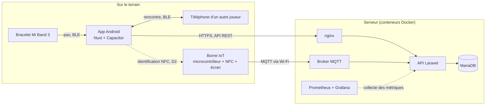
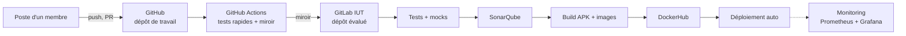

# Cahier des charges — Scubanion

- **Projet** : Scubanion · **Équipe** : Scubatana · Projet BUT3-IoT (IUT)
- **Membres** : BANDIERAS Thomas · DALMASSO Evan · KARROUCHI Hamza · LESUEUR Shaleena
- **Version** : 0.2 du 08/10/2026
- **Sources** : cours R5.07, programme de R5.04, consignes de R5.01, notes de l'équipe, README et maquettes du dépôt

Ce document résume le projet et les règles à respecter. C'est notre référence commune et notre liste de suivi : on coche au fil de l'avancement, et chaque décision met le document à jour (par PR, comme le code). Les éléments marqués *proposition* sont à valider en équipe.

**Légende** : **Must** = indispensable au rendu · **Should** = prévu · **Could** = bonus si le temps le permet · `D1` à `D10` = décisions à prendre (§ 8).

---

## 1. Le projet en bref

- **Sujet imposé** : « Le projet BUT3-IoT porte sur l'exploration des adaptations possibles de l'être humain à son environnement grâce à l'IoT. »
- **Notre problématique** : comment réadapter l'homme à son environnement ?
- **Problème ciblé** : la sédentarité et l'isolement social.
- **Cible** : étudiants et jeunes actifs connectés.
- **Notre réponse** : un compagnon virtuel, façon Tamagotchi, qui ne grandit que si son propriétaire sort. *« Il ne grandit que si toi tu sors. »*

Comment ça marche :

1. Le joueur porte un **bracelet Mi Band 3** relié en Bluetooth (BLE) à l'app : ses pas font gagner de l'XP à son compagnon.
2. Des **quêtes géolocalisées** l'envoient vers des lieux réels : parcs, points d'intérêt.
3. Quand deux joueurs **se croisent physiquement** (détection BLE entre téléphones, recoupée par la géolocalisation côté serveur), leurs compagnons gagnent un bonus.
4. Des **bornes IoT** (lecteur NFC + écran), installées dans des lieux publics ou chez des partenaires, débloquent skins, récompenses, événements, jeux et énigmes. Exemple de collab : une borne au Decathlon de Châtelet-les-Halles qui débloque un skin exclusif.

## 2. Charte de projet

Cette section est notre engagement commun : ce que le projet doit atteindre (§ 2.1), comment on mesure si on y va (§ 2.2) et qui fait quoi dans les deux prochaines semaines (§ 2.3). Elle se relit à chaque jalon du § 9 et se met à jour comme le reste du document, par PR.

### 2.1 Objectifs SMART

**O1 — Produit.** Livrer au **12/12/2026** une application Android et une borne IoT fonctionnelles couvrant les **18 exigences *Must*** du § 5, et en faire la démonstration en direct le 13/01/2027.

| Critère | Comment il est tenu |
| --------- | ------------------- |
| Spécifique | Périmètre fermé : les 18 exigences *Must* (6 `APP-`, 4 `BRA-`, 4 `BOR-`, 4 `BCK-`). Les *Should* et *Could* sont hors objectif. |
| Mesurable | Cases *Must* cochées au § 5, sur 18. Démonstration réussie = les quatre briques (bracelet → app → serveur → borne) enchaînées sans intervention manuelle. |
| Atteignable | 11 semaines à 4 personnes. Les *Should* et *Could* servent de variable d'ajustement ; gel des fonctionnalités le 05/12. |
| Réaliste | C'est le livrable noté de la SAE et le support de la soutenance. |
| Temporel | Rendu le 12/12/2026, démonstration le 13/01/2027. |

**O2 — Industrialisation.** Mettre en service au **08/11/2026** un pipeline GitLab CI qui, à chaque fusion sur `master`, enchaîne tests → SonarQube → build → publication DockerHub → déploiement automatique, avec une couverture de tests d'au moins **60 %** et **aucun bug bloquant** SonarQube.

| Critère | Comment il est tenu |
| --------- | ------------------- |
| Spécifique | Les cinq étapes nommées, sur le dépôt GitLab IUT, déclenchées par la fusion sur `master`. |
| Mesurable | Pipeline vert de bout en bout ; couverture ≥ 60 % ; 0 bug bloquant ; 0 adresse IP et 0 secret en dur. |
| Atteignable | Les commandes de test existent déjà (`composer test`) ; chaque membre porte une étape du pipeline (§ 7). |
| Réaliste | Exigence explicite de R5.07, et elle est notée (§ 6.2). |
| Temporel | 08/11/2026, fin du jalon J2. |

**O3 — Validation terrain.** Valider le modèle économique avant le **29/11/2026** avec **3 partenaires parisiens** signataires d'une lettre d'intention et **30 testeurs** du campus ayant utilisé l'app pendant au moins 7 jours.

| Critère | Comment il est tenu |
| --------- | ------------------- |
| Spécifique | 3 lettres d'intention couvrant 3 segments distincts : une collectivité ou un office de tourisme, un lieu à billetterie, un commerce de proximité. Et 30 testeurs identifiés. |
| Mesurable | Nombre de lettres signées ; nombre de testeurs actifs au moins 7 jours ; grille tarifaire du Business Model Canvas confrontée en rendez-vous. |
| Atteignable | Le campus fournit le vivier de testeurs. 8 semaines pour 3 signatures, soit une quinzaine de rendez-vous à provoquer. |
| Réaliste | Répond aux attentes de R5.01 et R5.13, et lève les hypothèses non validées du Business Model Canvas ([docs/bmc-reponses-relecture.md](bmc-reponses-relecture.md)). |
| Temporel | 29/11/2026, fin du jalon J3. |

### 2.2 Indicateurs de suivi

| # | Indicateur | Mesure | Cible | Fréquence |
| - | ---------- | ------ | ----- | ---------- |
| K1 | Avancement du périmètre *Must* | Cases *Must* cochées au § 5, divisées par 18 | 100 % au 05/12 ; au moins 50 % au 08/11 | Hebdomadaire |
| K2 | Santé du pipeline | Part de pipelines verts sur `master` sur 7 jours, et durée médiane d'exécution | ≥ 90 % de verts, durée < 10 min | Hebdomadaire |
| K3 | Qualité du code | Couverture de tests et nombre de bugs bloquants ou critiques dans SonarQube | ≥ 60 % de couverture, 0 bloquant | À chaque pipeline, relevé le vendredi |
| K4 | Équilibre des contributions | Commits et revues de PR par membre sur 7 jours | Chacun : ≥ 5 commits et ≥ 2 revues | Hebdomadaire |
| K5 | Tenue du planning | Écart en jours entre la date prévue d'un jalon (§ 9) et la date du tag `vX.Y.Z` | ≤ 3 jours | À chaque jalon |

K4 existe parce que **Git est noté individuellement** (§ 6.5) : un membre qui ne committe pas est pénalisé même si l'équipe livre. Les indicateurs se relèvent en début de réunion hebdomadaire. Un indicateur hors cible **deux semaines de suite** déclenche un arbitrage : réduction du périmètre *Should* et *Could*, ou réaffectation d'un lot.

### 2.3 Plan d'action du 09 au 23/10/2026

Ces dix actions couvrent la fin du jalon J0 et le jalon J1 (§ 9). Le responsable est une personne nommée, pas un lot : les noms se remplissent à la réunion de cadrage du 09/10, en même temps que la décision `D9`.

| #   | Action                                                                                                                            | Livrable attendu                                                      | Lot                   | Responsable | Échéance        |
| --- | --------------------------------------------------------------------------------------------------------------------------------- | --------------------------------------------------------------------- | --------------------- | ----------- | ---------------- |
| A1  | Réunion de cadrage : trancher `D1` (connexion), `D2` (identification borne), `D3` (microcontrôleur), `D4` (compagnon), `D9` (rôles), `D10` (stratégie Git) | Compte rendu et § 8 mis à jour                                        | Toute l'équipe        | …           | **ven 09/10** |
| A2  | Chaque membre configure son identité Git : vrai nom et email du compte GitLab IUT                                                 | 4 commits de test signés du bon nom                                   | Toute l'équipe        | …           | lun 12/10        |
| A3  | Mettre en place le miroir GitHub → GitLab IUT et vérifier que le runner démarre (`D8`)                                           | Un push sur GitHub déclenche un pipeline sur GitLab                   | CI/CD et infra        | …           | mar 13/10        |
| A4  | Commander le matériel de la borne une fois `D3` tranchée : microcontrôleur, lecteur NFC, écran, boîtier                         | Commande passée, délai de livraison connu                            | Borne IoT             | …           | mar 13/10        |
| A5  | Trancher `D6` (hébergement) et `D7` (SonarQube), ouvrir les accès et les stocker en variables masquées                           | Serveur joignable, projet SonarQube créé                              | CI/CD et infra        | …           | jeu 15/10        |
| A6  | Écrire le modèle de données v1 en migrations Laravel : joueur, compagnon, activité, quête, lieu, rencontre                      | `php artisan migrate` passe sur MariaDB et sur SQLite                 | Back-end et données   | …           | ven 16/10        |
| A7  | Créer un `.gitlab-ci.yml` minimal : tests back et front, puis publication SonarQube                                               | Pipeline vert sur une branche, premier rapport Sonar                  | CI/CD et infra        | …           | lun 19/10        |
| A8  | Preuve de concept BLE : lire les pas du Mi Band 3 depuis l'app, et versionner `docs/android-ble-miband3.md`                        | Nombre de pas affiché à l'écran + protocole documenté              | App mobile et bracelet | …           | mar 20/10        |
| A9  | API d'authentification selon `D1`, couverte par des tests                                                                         | Inscription et connexion par jeton, tests verts (`APP-01`, `BCK-01`)  | Back-end et données   | …           | mer 21/10        |
| A10 | Assainir l'image du back (multi-stage) et le compose de prod (retirer `laravel_code`, réseaux explicites, healthchecks), puis taguer `v0.1.0` et reporter les décisions prises dans ce document | Tag `v0.1.0` déployé, § 11 mis à jour                             | CI/CD et infra        | …           | **ven 23/10** |

**Règles de suivi.** Point d'équipe chaque vendredi : chaque responsable dit *fait / en cours / bloqué*. Une action non terminée est reportée **avec sa cause écrite**, jamais effacée. Toute action nouvelle entre dans ce tableau avec un responsable et une échéance, sinon elle n'existe pas.

**Déséquilibre assumé.** Quatre des dix actions relèvent du lot CI/CD et infra : c'est la nature du jalon « Fondations », où le pipeline conditionne tout le reste. À la réunion du 09/10, répartir ces quatre actions entre **deux membres au moins**, pour éviter le point unique de défaillance et parce que R5.07 demande que chaque membre contribue au pipeline.

## 3. Calendrier et livrables

| Échéance      | Date                                       | Contenu                                                       |
| --------------- | ------------------------------------------ | ------------------------------------------------------------- |
| Rendu           | **samedi 12/12/2026**                | Dépôt GitLab IUT + documentation                            |
| Soutenance      | **mercredi 13/01/2027**, après-midi | Présentation et démo                                        |
| Contrôle R5.07 | à confirmer                               | Écrit individuel de 60 min sur le cours, avec un peu de code |

Jalons intermédiaires : § 9.

## 4. Architecture

| Brique                | Techno                                                   | Pourquoi                                                                                                | État            |
| --------------------- | -------------------------------------------------------- | ------------------------------------------------------------------------------------------------------- | ---------------- |
| App mobile            | Nuxt 4, Vue 3, TypeScript, Capacitor 8 (Android)         | Une seule base web, accès natif au BLE par plugin                                                      | Socle posé      |
| Bracelet              | Xiaomi Mi Band 3 en BLE direct, sans l'app Xiaomi        | Podomètre abordable, protocole documenté par des projets open source (ex. Gadgetbridge)               | À prototyper    |
| Borne                 | ESP32, Arduino ou Raspberry Pi + lecteur NFC + écran    | Vrai système cyber-physique, programmé par l'équipe                                                  | À choisir (D3)  |
| API                   | PHP 8.3, Laravel 13                                      | ORM, migrations, authentification et tests intégrés                                                   | Squelette        |
| Base de données      | MariaDB 11.4                                             | Données très relationnelles (amitiés, inventaires, passages) : un SGBD plutôt que des fichiers JSON | Conteneur prêt  |
| Messagerie IoT        | MQTT (broker type Mosquitto)                             | Pub/sub léger, fait pour les objets contraints (vu en R5.04)                                           | À faire         |
| Flux d'événements   | Kafka                                                    | Découpler la réception des événements des règles de jeu, pouvoir les rejouer (vu en R5.04)         | À évaluer (D5) |
| Standard IoT          | oneM2M                                                   | Décrire les bornes selon un standard (vu en R5.04)                                                     | À évaluer (D5) |
| Reverse proxy         | nginx                                                    | Point d'entrée HTTP unique                                                                             | Conteneur prêt  |
| Admin BDD             | phpMyAdmin                                               | En développement uniquement                                                                            | Conteneur prêt  |
| CI/CD                 | GitHub Actions + GitLab CI (runner IUT)                  | Dépôt de travail sur GitHub, miroir évalué sur GitLab IUT (§ 6.5)                                  | À faire         |
| Qualité              | SonarQube                                                | Exigé par R5.07                                                                                        | À faire (D7)    |
| Registre d'images     | DockerHub                                                | Exigé par R5.07                                                                                        | À faire         |
| Hébergement          | Azure ou autre, hôte configuré par Ansible (optionnel) | Exigé par R5.07                                                                                        | À choisir (D6)  |
| Monitoring            | Prometheus + Grafana (+ Alertmanager)                    | Pile vue en R5.07                                                                                       | À faire         |
| Passage à l'échelle | Docker Swarm (réplicas de l'API)                        | Bonus R5.07                                                                                             | Bonus            |

## 5. Exigences fonctionnelles

### 5.1 App mobile (Android)

- [ ] **APP-01** · Must — Inscription et connexion (mode à choisir, D1).
- [ ] **APP-02** · Must — Profil : pseudo, date de naissance, genre (facultatif), ambition (retrouver la forme, sortir plus souvent, rencontrer du monde, explorer son quartier). L'ambition oriente les quêtes et les objets débloqués.
- [ ] **APP-03** · Must — Compagnon animé : niveau, XP et état (humeur, santé) qui évoluent avec l'activité réelle.
- [ ] **APP-04** · Must — Objectif de pas du jour (5 000 par défaut) et compteur en direct.
- [ ] **APP-05** · Must — Quêtes : quiz, photos de sortie, nouveaux lieux, rencontres, défi de la semaine.
- [ ] **APP-06** · Must — Consentements explicites (localisation, Bluetooth, activité) et suppression du compte (RGPD, § 6.5).
- [ ] **APP-07** · Should — Amis : liste, invitation par code, activité des amis.
- [ ] **APP-08** · Should — Rencontres : deux joueurs qui se croisent gagnent un bonus (BLE entre téléphones, recoupé par la géolocalisation côté serveur).
- [ ] **APP-09** · Should — Carte : lieux, bornes et quêtes à proximité, recherche.
- [ ] **APP-10** · Could — Équipes : marcher ensemble fait grandir les deux compagnons plus vite.
- [ ] **APP-11** · Could — Chat entre amis et en équipe.
- [ ] **APP-12** · Could — Notifications (« passe au parc avant 20 h pour une quête bonus »).

### 5.2 Bracelet (Mi Band 3)

- [ ] **BRA-01** · Must — Appairage BLE direct avec l'app, sans l'app officielle Xiaomi (authentification du bracelet comprise).
- [ ] **BRA-02** · Must — Lecture des pas en temps réel, avec rattrapage à la reconnexion.
- [ ] **BRA-03** · Must — Envoi des pas au serveur, avec une file d'attente locale quand le réseau coupe.
- [ ] **BRA-04** · Must — Protocole BLE documenté dans `docs/android-ble-miband3.md`.
- [ ] **BRA-05** · Could — Vibration ou notification sur le bracelet (quête terminée, ami croisé).
- [ ] **BRA-06** · Could — Repli sur le podomètre du téléphone pour les joueurs sans bracelet.

### 5.3 Borne IoT

- [ ] **BOR-01** · Must — Matériel choisi et justifié : microcontrôleur, lecteur NFC, écran (D3).
- [ ] **BOR-02** · Must — Identification du joueur par NFC (D2), sans exposer son identifiant brut (jeton temporaire ou signé).
- [ ] **BOR-03** · Must — Communication avec le serveur en MQTT, via Wi-Fi.
- [ ] **BOR-04** · Must — Récompense au passage (skin, objet ou XP), affichée à l'écran et ajoutée à l'inventaire du joueur.
- [ ] **BOR-05** · Should — Événements limités dans le temps (bonus d'un week-end, skin de saison).
- [ ] **BOR-06** · Should — Jeux et énigmes à résoudre sur la borne.
- [ ] **BOR-07** · Should — Collabs : une borne chez un partenaire débloque un contenu exclusif (ex. Decathlon Châtelet-les-Halles).
- [ ] **BOR-08** · Should — Signal de vie envoyé au serveur, visible dans le monitoring.
- [ ] **BOR-09** · Could — Mode hors ligne : les passages sont stockés puis renvoyés au retour du réseau.

Topics MQTT (*proposition*) :

| Topic                               | Sens             | Contenu                                                           |
| ----------------------------------- | ---------------- | ----------------------------------------------------------------- |
| `scubanion/bornes/{id}/passages`  | borne → serveur | Un joueur s'est identifié                                        |
| `scubanion/bornes/{id}/affichage` | serveur → borne | Ce que l'écran doit montrer (récompense, énigme, erreur)       |
| `scubanion/bornes/{id}/etat`      | borne → serveur | Signal de vie ; un*Last Will* MQTT signale une borne hors ligne |

### 5.4 Back-end, données et web

- [ ] **BCK-01** · Must — API REST pour l'app : authentification par jeton, joueur, compagnon, pas, quêtes, amis.
- [ ] **BCK-02** · Must — Base MariaDB : infos joueur, amitiés, compagnon, et le reste du modèle ci-dessous.
- [ ] **BCK-03** · Must — Règles de jeu calculées côté serveur (XP, niveaux, validation des quêtes et des passages), avec des garde-fous simples contre la triche (plafond de pas par heure, cohérence des positions).
- [ ] **BCK-04** · Must — Abonné MQTT qui traite les passages en borne et répond à la borne.
- [ ] **BCK-05** · Should — Kafka pour le flux d'événements (pas, passages, rencontres), si l'intérêt est démontré (D5).
- [ ] **BCK-06** · Could — Ressources oneM2M pour décrire les bornes (D5).
- [ ] **BCK-07** · Could — Application web de consultation (compagnon, historique, quêtes), construite à partir des maquettes de `scubatana.demo`.
- [ ] **BCK-08** · Could — Back-office pour créer quêtes, événements, skins et partenaires.

Modèle de données (v0, à affiner) :

| Entité                 | Contenu principal                                                                                                      |
| ----------------------- | ---------------------------------------------------------------------------------------------------------------------- |
| Joueur                  | Pseudo, contact (téléphone ou email selon D1), date de naissance, genre (facultatif), ambition, consentements        |
| Compagnon               | Joueur, nom, espèce, niveau, XP, humeur et santé, skin porté. Le volet « relation, login » reste à définir (D4) |
| Amitié                 | Deux joueurs, statut (en attente, acceptée), date                                                                     |
| Activité               | Joueur, jour, nombre de pas, source (bracelet, téléphone)                                                            |
| Quête, progression     | Type, objectif, récompense ; avancement de chaque joueur                                                              |
| Lieu                    | Nom, coordonnées, type (parc, point d'intérêt, partenaire)                                                          |
| Borne, passage          | Lieu, partenaire éventuel, état, dernier signal ; passages (joueur, borne, date, récompense)                        |
| Récompense, inventaire | Type (skin, objet, XP), origine (quête, borne, événement, collab) ; objets possédés par chaque joueur             |
| Événement             | Période, bornes concernées, récompense                                                                              |
| Partenaire              | Nom, bornes, contenus exclusifs                                                                                        |
| Rencontre               | Deux joueurs, date, zone approximative, validée ou non                                                                |
| Équipe, message        | Seulement si APP-10 et APP-11 sont faits                                                                               |

## 6. Règles à respecter

### 6.1 Consignes communes

- [ ] Le projet est commun à **R5.01** (management d'une équipe de projet), **R5.13** (économie durable et numérique), **R5.04** (programmation avancée) et **R5.07** (automatisation de la chaîne de production).
- [ ] Les technologies sont libres, mais **chaque choix est motivé** et l'architecture est adaptée (exemple du cours : base de données ou fichier JSON). L'équipe se débrouille seule sur les technos qu'elle a choisies.
- [ ] Rendu : dépôt GitLab IUT + documentation, le 12/12. Soutenance le 13/01 après-midi.

La lettre de commande et les consignes détaillées de R5.01, R5.13 et R5.04 n'ont pas été communiquées : **à compléter dès réception**.

### 6.2 R5.07 — Automatisation de la chaîne de production

Évaluation : dépôt (coeff. 1) + soutenance (coeff. 1) + contrôle écrit individuel de 60 min (coeff. 1). La documentation fait partie du rendu. **Tous les membres doivent contribuer au pipeline.**

Pipeline de déploiement continu exigé :

- [ ] 1. Lancer automatiquement les tests unitaires.
- [ ] 2. Construire l'application.
- [ ] 3. Publier les résultats sur un SonarQube.
- [ ] 4. Publier les images Docker sur DockerHub.
- [ ] 5. Pouvoir lancer l'application avec un fichier docker-compose.
- [ ] 6. Déployer automatiquement sur Azure ou ailleurs (Ansible possible pour configurer l'hôte).
- [ ] 7. *Bonus* : faire passer à l'échelle les services qui en ont besoin.
- [ ] 8. Mettre en place une pile de monitoring.
- [ ] Stratégie Git définie et documentée.
- [ ] Déclencheurs du pipeline définis et documentés.
- [ ] Documentation qui accompagne le pipeline.

Grille d'évaluation, à relire avant le rendu :

- **Fonctionnement et documentation**
  - [ ] Le pipeline fonctionne de bout en bout.
  - [ ] La documentation est claire et explique les choix de conception.
- **Git** (sur GitLab IUT, noté pour chaque étudiant)
  - [ ] La stratégie d'utilisation du dépôt est respectée.
  - [ ] Chacun des 4 membres fait des commits réguliers et bien documentés.
- **Tests**
  - [ ] Les tests sont de qualité.
  - [ ] Mocks et autres types de tests (fonctionnels, intégration).
- **Construction**
  - [ ] Dépendances bien gérées, conception modulaire.
  - [ ] Images Docker de qualité : taille réduite, pas d'IP en dur.
  - [ ] Rapports SonarQube au vert.
- **Déploiement**
  - [ ] docker-compose de qualité (pas d'IP en dur, réseaux) et fichiers Ansible.
  - [ ] Mécanisme de passage à l'échelle expliqué, s'il est mis en place.
  - [ ] Mécanisme de monitoring expliqué.

### 6.3 R5.04 — Programmation avancée (IoT)

Consigne : « Vous utiliserez ce que nous avons vu en cours. Votre code sera évalué. »

Programme : systèmes IoT et cyber-physiques (CPS) · supports de communication et échange de données · standards pour l'IoT · frameworks de développement et de déploiement IoT. Vus à ce jour : MQTT, Kafka, oneM2M (liste à compléter au fil du cours).

| Thème du cours                                 | Dans Scubanion                                                                                                                 |
| ----------------------------------------------- | ------------------------------------------------------------------------------------------------------------------------------ |
| Systèmes cyber-physiques                       | La borne : un geste physique (badge NFC) déclenche un effet dans le jeu. Le bracelet mesure l'activité réelle.              |
| Supports de communication                       | BLE (bracelet ↔ téléphone, téléphone ↔ téléphone), NFC (joueur ↔ borne), Wi-Fi (borne ↔ serveur), HTTPS (app ↔ API) |
| Standards et protocoles                         | MQTT (borne ↔ serveur) ; Kafka et oneM2M à évaluer (D5)                                                                     |
| Frameworks de développement et de déploiement | À compléter avec le cours (côté borne : framework Arduino ou ESP-IDF)                                                      |

- [ ] Chaque protocole ou standard utilisé est justifié dans la documentation.
- [ ] Si un outil vu en cours n'est pas retenu, la raison est écrite.

### 6.4 R5.01 et R5.13

Connu à ce jour : constituer les groupes, organiser le travail au sein du groupe, prendre en compte le côté « business ». Un flyer de pitch (3 minutes) existe déjà : `scubatana.demo/flyer.html`.

Livrables produits à ce jour :

| Livrable                       | Fichier                                                                          | État                                                                   |
| ------------------------------ | -------------------------------------------------------------------------------- | ---------------------------------------------------------------------- |
| Flyer de pitch (3 min)         | `scubatana.demo/flyer.html`                                                      | Fait                                                                   |
| Business Model Canvas          | [business-model-canvas.html](business-model-canvas.html) (source) et [business-model-canvas.pdf](business-model-canvas.pdf) (à rendre) | Version 2 du 08/10/2026, revue après relecture. Page 1 le canvas, page 2 et 3 les annexes |
| Réponses à la relecture du BMC | [bmc-reponses-relecture.md](bmc-reponses-relecture.md)                           | Un commentaire = une correction ; sert d'appui pour la présentation |
| Charte de projet               | § 2                                                                              | Objectifs SMART, indicateurs, plan d'action                            |

Le Business Model Canvas laisse cinq hypothèses ouvertes (grille tarifaire B2B, taille du marché, coût unitaire de la borne, lecture de la variabilité cardiaque, validité des personas). Elles sont listées en fin de `bmc-reponses-relecture.md` et l'objectif **O3** du § 2.1 est ce qui doit les lever.

Pistes, à confirmer quand les consignes arriveront :

- Modèle économique : abonnement par borne chez les partenaires, quêtes sponsorisées facturées au passage, parcours vendus aux collectivités, programme bien-être pour les employeurs et mutuelles. Le détail et le chiffrage sont dans le Business Model Canvas.
- Numérique responsable : échanges et consommation d'énergie sobres (bracelet, bornes), matériel réutilisable. Aucune publicité dans l'app, par cohérence avec cet axe.
- Organisation : rôles (§ 7), décisions (§ 8), planning (§ 9), suivi par ce document.

### 6.5 Nos règles d'équipe (*proposition*)

**Dépôts**

- **GitHub** (`Picsou06/scubanion`) est le dépôt de travail : branches, PR, revues.
- Une GitHub Action le **copie automatiquement sur GitLab IUT** (toutes les branches et tous les tags). C'est ce miroir que les enseignants évaluent, et son runner exécute le pipeline officiel.
- Les PR ne sont pas copiées sur GitLab. On fusionne donc avec un commit de merge (pas de squash) : les commits de chacun et les numéros de PR restent visibles dans l'historique.

**Branches** (GitHub Flow : simple, adapté au déploiement continu)

- `master` : protégée, toujours déployable, déployée automatiquement. Pas de push direct.
- `feature/<sujet>` et `fix/<sujet>` : une branche par tâche, fusionnée par PR quand la CI est verte et qu'un autre membre a relu.
- Tags `vX.Y.Z` : une release par jalon (§ 9).

**Commits**

- Format Conventional Commits, message en français : `feat: jauge de pas sur l'accueil`, `fix: …`, `test: …`, `docs: …`, `ci: …`.
- Des commits petits et réguliers : Git est noté pour chaque membre.
- Chacun configure son vrai nom (`git config --global user.name "Prénom Nom"`) et l'email de son compte GitLab IUT. Sinon, ses commits ne sont pas rattachés au bon étudiant.

**Déclencheurs du pipeline**

| Événement              | GitHub Actions        | GitLab CI (runner IUT)                                                  |
| ------------------------ | --------------------- | ----------------------------------------------------------------------- |
| Push sur une branche, PR | Tests rapides, miroir | Tests, analyse SonarQube                                                |
| Merge sur`master`      | Miroir                | Tests → SonarQube → build (APK + images) → DockerHub → déploiement |
| Tag`vX.Y.Z`            | Miroir                | Idem + release : APK signé et images taguées`vX.Y.Z`                |

- **Seul GitLab CI déploie.** GitHub Actions se limite aux tests rapides et au miroir.
- Les commandes de test et de build sont des scripts du projet (`composer test`, scripts npm, Dockerfiles), appelés par les deux CI : aucune logique n'est écrite deux fois.

**Qualité et sécurité**

- [ ] Aucune IP ni aucun secret en dur : noms de services Docker et variables d'environnement. Les secrets (tokens DockerHub et SonarQube, clé SSH, mots de passe du keystore) vont dans les variables masquées des CI.
- [ ] Images Docker : multi-stage, base alpine, application construite avant et seul le résultat copié, sans dépendances de dev, avec `.dockerignore` et `HEALTHCHECK`.
- [ ] docker-compose : réseaux explicites, healthchecks, `depends_on` conditionnels, volumes réservés aux données.
- [ ] Tests unitaires et fonctionnels, mocks pour le BLE, le MQTT et les services externes, couverture suivie dans SonarQube.

**Données personnelles (RGPD)**

L'app traite des données personnelles : position, activité physique, rencontres entre joueurs, date de naissance.

- [ ] Consentement explicite et retirable pour la localisation, le Bluetooth et l'activité.
- [ ] Minimisation : pas d'historique GPS brut conservé, rencontres enregistrées avec une zone approximative.
- [ ] Durée de conservation définie ; suppression du compte et des données sur demande.
- [ ] Âge minimum fixé : en France, un mineur consent seul à partir de 15 ans.

## 7. Organisation de l'équipe

Les rôles ne sont pas encore attribués (D9). *Proposition* : un référent par lot, et chaque membre porte une étape du pipeline, ce qui garantit que tout le monde y contribue (exigence R5.07).

| Membre           | Référent du lot | Étape du pipeline |
| ---------------- | ----------------- | ------------------ |
| BANDIERAS Thomas | à définir       | à définir        |
| DALMASSO Evan    | à définir       | à définir        |
| KARROUCHI Hamza  | à définir       | à définir        |
| LESUEUR Shaleena | à définir       | à définir        |

- **Lots** : app mobile et bracelet · borne IoT · back-end et données · CI/CD et infra.
- **Étapes du pipeline** : tests et SonarQube · build et images DockerHub · déploiement (compose, Ansible) · monitoring et passage à l'échelle.

## 8. Décisions à prendre

|     | Décision                                 | Options                                                                                                                                         | À savoir                                                                                                                                                    | Avant le                                |
| --- | ----------------------------------------- | ----------------------------------------------------------------------------------------------------------------------------------------------- | ------------------------------------------------------------------------------------------------------------------------------------------------------------ | --------------------------------------- |
| D1  | Mode de connexion                         | SMS + code (maquettes), email + code, email + mot de passe                                                                                      | Les SMS sont payants (Twilio…), un code par email est gratuit                                                                                               | 11/10                                   |
| D2  | Identification à la borne                | Téléphone en émulation de carte (HCE) ; tag NFC personnel (autocollant, carte) ; ou l'inverse : le téléphone lit un tag posé sur la borne | Le Mi Band 3 standard n'a pas de NFC utilisable. La HCE demande du code Android natif et un lecteur qui gère l'ISO-DEP (le PN532 oui, le RC522 mal)         | 11/10                                   |
| D3  | Microcontrôleur de la borne              | ESP32, Arduino, Raspberry Pi                                                                                                                    | ESP32 : Wi-Fi et BLE intégrés, peu cher, sobre. Arduino Uno : pas de réseau sans module. Raspberry Pi : Linux et écran riche, plus cher et plus gourmand | 11/10, pour avoir le temps de commander |
| D4  | Compagnon : « relation » et « login » | À définir                                                                                                                                     | Conditionne le modèle de données                                                                                                                           | 11/10                                   |
| D5  | Kafka et oneM2M                           | Utilisés, ou écartés avec une justification écrite                                                                                          | R5.04 demande d'utiliser ce qui est vu en cours                                                                                                              | 31/10                                   |
| D6  | Hébergement                              | Azure for Students, VM de l'IUT, autre                                                                                                          | Les crédits Azure sont limités                                                                                                                             | 18/10                                   |
| D7  | SonarQube                                 | Instance de l'IUT, auto-hébergé                                                                                                               |                                                                                                                                                              | 18/10                                   |
| D8  | Miroir GitHub → GitLab                   | GitHub Action, double push depuis les postes                                                                                                    | Vérifier que le GitLab IUT est joignable depuis GitHub                                                                                                      | 04/10                                   |
| D9  | Rôles                                    | Voir § 7                                                                                                                                       |                                                                                                                                                              | 04/10                                   |
| D10 | Stratégie Git                            | Proposition du § 6.5                                                                                                                           |                                                                                                                                                              | 04/10                                   |

## 9. Planning (*proposition*)

| Période       | Jalon                                      | Contenu                                                                                                                                                                                 |
| -------------- | ------------------------------------------ | --------------------------------------------------------------------------------------------------------------------------------------------------------------------------------------- |
| 24/09 → 04/10 | **J0 Cadrage**                       | Cahier des charges validé, rôles, stratégie Git, miroir GitLab (D8 à D10)                                                                                                           |
| 05/10 → 18/10 | **J1 Fondations** · `v0.1.0`      | Pipeline minimal (tests + SonarQube), modèle de données, API d'authentification, lecture des pas du Mi Band 3 (preuve de concept), matériel de la borne commandé (D1 à D4, D6, D7) |
| 19/10 → 08/11 | **J2 Cœur du jeu** · `v0.2.0`    | Compagnon, XP, quêtes, synchro des pas, broker MQTT, prototype de borne (NFC → MQTT → serveur)                                                                                       |
| 09/11 → 29/11 | **J3 Social et borne** · `v0.3.0` | Amis, rencontres, récompenses et événements en borne ; images DockerHub, déploiement auto, monitoring                                                                               |
| 30/11 → 12/12 | **J4 Stabilisation** · `v1.0.0`   | Gel des fonctionnalités le 05/12, tests, qualité SonarQube, documentation,**rendu le 12/12**                                                                                    |
| 13/12 → 13/01 | **J5 Soutenance**                    | Démo (app + bracelet + borne), support, répétitions                                                                                                                                  |

## 10. Risques

| Risque                                                                                                                        | Parade                                                                                                          |
| ----------------------------------------------------------------------------------------------------------------------------- | --------------------------------------------------------------------------------------------------------------- |
| Le protocole du Mi Band 3 (authentification, firmware) bloque la lecture des pas                                              | Preuve de concept dès J1 ; repli sur le podomètre du téléphone (BRA-06)                                     |
| Rencontres BLE : le plugin`@capacitor-community/bluetooth-le` ne gère que le rôle central, pas l'émission d'annonces BLE | Autre plugin ou code Android natif pour émettre ; à valider tôt, sinon rencontres par géolocalisation seule |
| Android limite le Bluetooth en arrière-plan pour économiser la batterie                                                     | Service au premier plan, ou détection seulement quand l'app est ouverte                                        |
| Délais de livraison du matériel de la borne                                                                                 | Trancher D3 et commander avant le 11/10                                                                         |
| GitLab IUT injoignable depuis GitHub Actions                                                                                  | Double push depuis les postes, ou runner auto-hébergé                                                         |
| Trop de fonctionnalités pour 11 semaines                                                                                     | Priorités Must / Should / Could, gel le 05/12                                                                  |
| Connaissances non partagées (ex.`docs/android-ble-miband3.md`, cité dans le README mais absent du dépôt)                | Tout documenter dans`docs/`, relectures croisées                                                             |
| Crédits d'hébergement épuisés                                                                                             | Surveiller la consommation, prévoir une VM de repli                                                            |
| Données personnelles (position, rencontres)                                                                                  | Règles RGPD du § 6.5                                                                                          |

## 11. État du dépôt au 24/09/2026

En place : Nuxt 4 + Capacitor (Android, plugin BLE), Laravel 13, MariaDB 11.4, nginx, phpMyAdmin, maquettes HTML des écrans. Pas encore de code métier : écran d'accueil provisoire, squelette Laravel, tests d'exemple.

Écarts à corriger :

- [ ] Mettre en place le miroir GitHub → GitLab IUT (D8).
- [ ] Chaque membre configure son identité Git : vrai nom et email du compte GitLab IUT.
- [X] Retirer `docs/` du `.gitignore` pour versionner la documentation.
- [ ] Récupérer et versionner `docs/android-ble-miband3.md`.
- [ ] Renommer Scoubanion en Scubanion : README, `capacitor.config.json`, `nuxt.config.ts`, `app.vue`, `strings.xml`, `APP_NAME` du back, maquettes. Le fichier et l'alias du keystore peuvent garder l'ancien nom.
- [ ] Image du back : build multi-stage avec `composer install --no-dev` pendant le build. Aujourd'hui, les dépendances (dev comprises) sont installées au démarrage du conteneur, et git et unzip restent dans l'image.
- [ ] Compose de prod : supprimer le volume partagé `laravel_code`. Il garde l'ancien code après chaque redéploiement ; le code doit être dans les images.
- [ ] Compose : réseaux explicites, healthchecks, `depends_on` avec `condition: service_healthy`.
- [ ] Image du front : elle lance le serveur de développement (`npm run dev`) ; prévoir une image de prod si une app web est servie (BCK-07).
- [ ] Remplacer les tests d'exemple par de vrais tests.
- [ ] Créer `.gitlab-ci.yml` et `.github/workflows/`.

## 12. Historique du document

| Version | Date       | Changements                                                                                                               |
| ------- | ---------- | ------------------------------------------------------------------------------------------------------------------------- |
| 0.1     | 24/09/2026 | Première version : résumé du projet, règles des matières, exigences, décisions, planning, risques, état du dépôt |
| 0.2     | 08/10/2026 | Ajout de la charte de projet (§ 2) : 3 objectifs SMART, 5 indicateurs de suivi, plan d'action du 09 au 23/10. Sections 2 à 11 renumérotées en 3 à 12. Business Model Canvas v2 référencé au § 6.4 |
