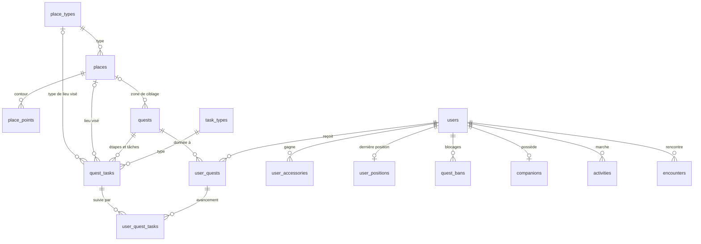

# Modèle de données

Ce document décrit les tables en place dans la base MariaDB. Le schéma est géré par les migrations Laravel (`scubatana.backend/database/migrations`) : c'est la seule source de vérité, ce document en est le résumé. Les besoins d'origine sont au § 5.4 du [cahier des charges](cahier-des-charges.md) ; la conception des quêtes suit la proposition d'Evan sur la PR #10.

## Vue d'ensemble

Tables antérieures, non redessinées : `users`, `companions`, `activities` (les pas d'un jour, par téléphone), et les tables techniques `login_codes`, `personal_access_tokens`, `sessions`, `cache`, `jobs`.

## Catalogue : ce qui se configure

Les types, les textes, les conditions et les lieux sont des **données** : on en ajoute ou on en change sans livrer l'app ni écrire de migration.

| Table | Rôle | Points notables |
| ----- | ---- | --------------- |
| `place_types` | Les types de lieux | `code`, `label`, `icon`, `color`, `on_map` (affiché sur la carte ou non), `active`. Livrés avec : `park`, `point_of_interest`, `partner`, `bus_stop`, et `zone` (non affiché, sert au ciblage). |
| `places` | Un lieu ponctuel ou une grande zone | `latitude` et `longitude` (point de référence), `radius_m` pour un lieu ponctuel, rectangle englobant (`min_lat`, `max_lat`, `min_lng`, `max_lng`) pour une zone. `attributes` (JSON libre), `source` et `external_id` pour les imports (unique ensemble), `synced_at`, `active`. |
| `place_points` | Le contour d'une grande zone | Les sommets dans l'ordre (`position`) : 4 pour un carré, autant qu'il faut pour une forêt. |
| `task_types` | Les types de tâches | `code`, `label`, `app_action`, `params_schema` (forme attendue des paramètres), `active`. |
| `quests` | Les quêtes | `name`, `description`, `icon`, récompense (`reward_xp`, `reward_accessory`), attribution (`auto_assign`, `target_ambition`, `target_zone_id`), `repeat` (`once`, `daily`, `weekly`), `starts_at`, `ends_at`, `status` (`draft`, `published`, `archived`). |
| `quest_tasks` | Les tâches d'une quête, rangées par étape | `step`, `position`, `task_type_id`, `description`, `target`, lieu visé (`place_id`) ou type de lieu visé (`place_type_id`), `params` (JSON). Plusieurs tâches partagent le même `step` : il faut toutes les finir pour débloquer l'étape suivante. |

**`app_action`.** L'app ne connaît que cinq actions : `auto` (le serveur fait avancer seul, comme les pas), `checkin` (le joueur envoie sa position), `scan` (il scanne un code), `answer` (il répond à un quiz), `meet` (il croise un joueur). Un nouveau type de tâche qui réutilise une de ces actions ne demande aucune mise à jour de l'app. Livrés avec : `steps` (auto), `visit_place` et `visit_place_type` (checkin), `scan_code` (scan), `quiz` (answer), `meet_player` (meet).

**Lieu ponctuel ou zone.** Un lieu sans points se valide par son rayon (`radius_m`, ou 100 m par défaut) ; un lieu avec points se valide par « dedans ou dehors » du contour, après un premier filtre sur le rectangle englobant. C'est `Place::contains()`.

## Côté joueur

| Table | Rôle | Points notables |
| ----- | ---- | --------------- |
| `user_quests` | Une quête donnée à un joueur pour une période | `period` vaut `once`, un jour (`2026-10-13`) ou une semaine ISO (`2026-W42`) ; unique par joueur, quête et période. `current_step`, `source` (`rule` pour une attribution automatique, `manual` pour un admin), `assigned_at`, `expires_at` (le plus tôt entre la fin de la quête et la fin de la période), `completed_at`, `failed_at`, `reward_xp` (l'XP effectivement gagnée). |
| `user_quest_tasks` | L'avancement d'une tâche | `value`, `baseline` (la valeur de départ au déblocage de l'étape, par exemple le total de pas du joueur à ce moment), `completed_at`. |
| `user_accessories` | Les accessoires gagnés | `accessory`, `quest_id` (la quête qui l'a donné), `unlocked_at`. Unique par joueur et accessoire. |
| `user_positions` | La dernière position connue | Une seule ligne par joueur, remplacée à chaque nouvelle position : `latitude`, `longitude`, `accuracy_m`, `mocked` (position simulée signalée par Android), `recorded_at`. |
| `quest_bans` | Les blocages sur les tâches de localisation | `reason`, `evidence` (JSON), `starts_at`, `ends_at`. |
| `encounters` | Deux joueurs qui se sont croisés (APP-08) | Voir ci-dessous. |

## Règles garanties par la base et les modèles

- **Rien d'utilisé ne disparaît.** Une quête, une tâche, un lieu ou un type déjà utilisés ne peuvent pas être supprimés : clés étrangères en `restrict`. Une quête sans joueur se supprime avec ses tâches.
- **Une quête commencée ne change plus de structure.** Dès qu'un joueur l'a reçue, seuls son nom, sa description, son icône et son statut (pour l'archiver) peuvent changer, et pour ses tâches seule la description. Ajouter, retirer ou modifier une tâche lève une erreur (`Quest` et `QuestTask`).
- **Supprimer un compte efface tout ce qui le concerne** : ses quêtes, leur avancement, ses accessoires, sa position, ses blocages et ses rencontres (en cascade).
- **Un blocage ne gêne que la localisation.** `User::isBannedFromLocationTasks()` dit si un blocage est en cours.

## Rencontres

`encounters` garde une ligne par paire, toujours dans le même ordre : le modèle `Encounter` range le plus petit identifiant dans `user_id`, le plus grand dans `other_user_id`, et refuse qu'un joueur se rencontre lui-même. `Encounter::involving($joueur)` retrouve les rencontres d'un joueur des deux côtés.

Pour respecter la minimisation du RGPD, aucune coordonnée brute n'est gardée : `zone` contient un geohash de précision 6, soit une case d'environ 1,2 km sur 0,6 km. `validated_at` est renseigné une fois la rencontre recoupée côté serveur.

## Pour plus tard

Photos, import automatique des arrêts de bus et des zones (GTFS, OpenStreetMap), interface admin pour créer les quêtes, rôle admin en base, table des sponsors, consentements. Restent aussi à modéliser : bornes et passages (PR #18), événements, partenaires, amitiés (PR #17), équipes et messages.
