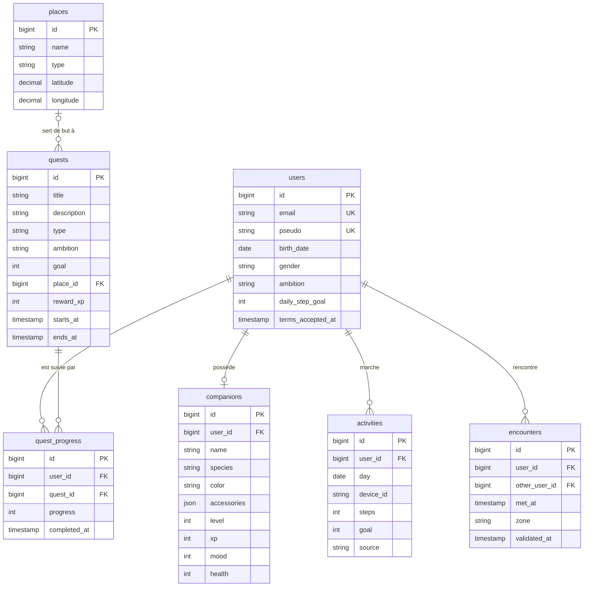

# Modèle de données

Ce document décrit les tables en place dans la base MariaDB. Le schéma est géré par les migrations Laravel (`scubatana.backend/database/migrations`) : c'est la seule source de vérité, ce document en est le résumé. Les besoins d'origine sont au § 5.4 du [cahier des charges](cahier-des-charges.md).

## Vue d'ensemble

Tables techniques non représentées : `login_codes` (codes de connexion à usage unique), `personal_access_tokens` (jetons Sanctum), `sessions`, `cache` et `jobs`.

## Tables

| Table | Rôle | Points notables |
| ----- | ---- | --------------- |
| `users` | Le joueur | Pas de mot de passe : connexion par email et code (D1). `ambition` oriente les quêtes (APP-02). |
| `companions` | Le compagnon du joueur, un seul par joueur | Apparence (base, couleur, accessoires) et état (niveau, XP, humeur, santé). |
| `activities` | Les pas d'une journée, par téléphone | Une ligne par joueur, jour et téléphone (`device_id`). Le total du jour est la somme des téléphones, plafonnée côté serveur. |
| `places` | Parcs, points d'intérêt, lieux partenaires | `type` vaut `park`, `point_of_interest` ou `partner`. Coordonnées en degrés décimaux, à 6 décimales (environ 10 cm). |
| `quests` | Les quêtes proposées | `type` vaut `steps`, `place`, `encounter`, `quiz` ou `photo` (APP-05). `goal` est la quantité à atteindre (pas, passages, rencontres…). `starts_at` et `ends_at` bornent un défi limité dans le temps, comme le défi de la semaine ; vides, la quête est permanente. |
| `quest_progress` | L'avancement d'un joueur sur une quête | Une seule ligne par joueur et par quête. La quête est terminée quand `completed_at` est renseigné. |
| `encounters` | Deux joueurs qui se sont croisés (APP-08) | Voir ci-dessous. |

## Choix de conception

**Rencontres : une ligne par paire, toujours dans le même ordre.** Le modèle `Encounter` range la paire avec le plus petit identifiant dans `user_id` et le plus grand dans `other_user_id`, et refuse qu'un joueur se rencontre lui-même. Une rencontre entre Léa et Yanis s'écrit donc de la même façon, quel que soit le téléphone qui la signale, ce qui évite les doublons et simplifie la recherche d'une paire. Le scope `Encounter::involving($joueur)` retrouve les rencontres d'un joueur des deux côtés.

**Rencontres : une zone, pas une position.** Pour respecter la minimisation exigée par le RGPD (§ 6.5 du cahier des charges), aucune coordonnée GPS brute n'est conservée. La colonne `zone` contient un geohash de précision 6, soit une case d'environ 1,2 km sur 0,6 km : assez pour recouper la rencontre avec la position annoncée par chaque téléphone, trop large pour suivre quelqu'un. `validated_at` est renseigné une fois la rencontre recoupée côté serveur.

**Suppressions.** Supprimer un joueur supprime en cascade son compagnon, ses journées de pas, sa progression dans les quêtes et ses rencontres : c'est ce qui permettra la suppression du compte (APP-06). À l'inverse, un lieu utilisé par une quête ne peut pas être supprimé (`restrictOnDelete`), pour qu'aucune quête ne pointe vers un lieu disparu.

**Énumérations.** Les valeurs fermées (`PlaceType`, `QuestType`, `Ambition`, `Gender`) sont des énumérations PHP dans `app/Enums`, stockées sous forme de chaînes. Ajouter une valeur ne demande donc pas de migration.

## Pas encore modélisé

Les tables suivantes du § 5.4 viendront avec leurs fonctionnalités : bornes et passages (attend D2 et D3), récompenses et inventaire, événements, partenaires, amitiés, équipes et messages.
