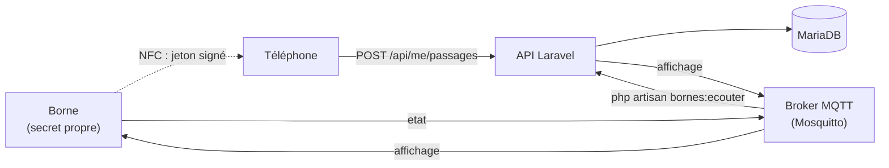

# Protocole des bornes

Ce document est le contrat entre le code de la borne et l'API : le jeton que la borne donne au téléphone, et les messages MQTT échangés avec le serveur (BOR-03, BCK-04, R5.04).



## Le passage, en résumé

1. Le joueur approche son téléphone de la borne.
2. La borne calcule un **jeton** avec son identifiant, l'heure du scan et son secret, et le transmet au téléphone par NFC.
3. Le téléphone envoie le jeton à l'API (`POST /api/me/passages`, voir [api/bornes.md](api/bornes.md)). Sans réseau, il le garde et l'envoie dans les 24 h.
4. L'API retrouve la borne grâce au jeton, vérifie la signature avec le secret de cette borne, vérifie l'heure, et refuse un jeton déjà utilisé.
5. L'API répond au téléphone, et publie le résultat sur le topic `affichage` de la borne, qui l'affiche à l'écran.

## Le jeton

Chaque borne a un **code** (son identifiant, en minuscules, chiffres et tirets) et un **secret**, donné une seule fois par `php artisan bornes:creer` et à enregistrer dans la borne. Le serveur garde le secret chiffré en base.

Format : `{code}.{heure}.{signature}`, en ASCII, 40 caractères au plus.

| Partie | Contenu |
| ------ | ------- |
| `code` | le code de la borne, par exemple `chateau-01` |
| `heure` | l'heure du scan en secondes Unix (UTC), écrite en base 36, minuscules |
| `signature` | HMAC-SHA256 de `{code}.{heure}` avec le secret de la borne comme clé, dont on garde les **12 premiers octets**, encodés en base64 URL sans `=` (16 caractères) |

Exemple, pour la borne `chateau-01` à 2026-10-13 13:00:00 UTC (`1791896400`, soit `tmuk40` en base 36) : `chateau-01.tmuk40.` suivi des 16 caractères de signature.

Règles appliquées par le serveur :

- la signature doit correspondre au secret de la borne nommée dans le jeton ;
- l'heure du scan doit dater de moins de 24 h et ne pas dépasser l'heure du serveur de plus de 5 minutes : **la borne doit être à l'heure (NTP)** ;
- un jeton ne sert qu'**une fois** : le serveur garde son empreinte (SHA-256) et refuse le même jeton ensuite, même présenté par un autre joueur. La borne génère donc un nouveau jeton à chaque scan.

`php artisan bornes:simuler {code}` affiche un jeton calculé exactement comme le ferait la borne, ce qui permet de tester l'app et l'API sans matériel.

## Topics MQTT

Préfixe : `scubanion/bornes/{code}/`. L'API ignore les bornes non déclarées.

| Topic | Sens | QoS | Contenu |
| ----- | ---- | --- | ------- |
| `scubanion/bornes/{code}/etat` | borne vers serveur | 1, message retenu | signal de vie, et testament de la borne |
| `scubanion/bornes/{code}/affichage` | serveur vers borne | 1 | ce que l'écran doit montrer après un passage |

Tous les messages sont en JSON, encodé en UTF-8.

### Signal de vie (`etat`)

```json
{ "status": "online", "firmware": "1.0.0" }
```

- La borne publie `online` à sa connexion, puis toutes les 30 secondes, en message retenu.
- Elle déclare à la connexion un testament sur le même topic : `{ "status": "offline" }`, retenu. Le broker le publie si elle disparaît sans se déconnecter proprement.
- L'API considère une borne hors ligne après 120 secondes sans signal.

### Affichage (`affichage`)

Publié par l'API dès qu'un passage est enregistré :

```json
{ "scanned_at": "2026-10-13T15:00:00+02:00", "status": "rewarded", "message": "Bravo Lea ! +100 XP", "reward_xp": 100 }
```

| `status` | Quand | `message` |
| -------- | ----- | --------- |
| `rewarded` | premier passage du joueur à cette borne ce jour-là | « Bravo {pseudo} ! +100 XP » |
| `already_rewarded` | le joueur est déjà passé ce jour-là : le passage est enregistré, sans récompense | « Déjà passé aujourd'hui, {pseudo}. Reviens demain ! » |

`scanned_at` reprend l'heure du jeton : la borne sait ainsi à quel scan correspond la réponse. Un jeton refusé (faux, expiré ou déjà utilisé) ne produit pas d'affichage : seul le téléphone reçoit l'erreur. Si le téléphone envoie le jeton plus tard (hors ligne), l'affichage arrive plus tard aussi ; la borne peut l'ignorer s'il est trop ancien.

## Côté serveur

| Commande | Rôle |
| -------- | ---- |
| `php artisan bornes:creer chateau-01 "Borne du Château" --lieu=3` | déclare une borne, rattachée à un lieu, et affiche son secret une seule fois |
| `php artisan bornes:ecouter` | écoute les signaux de vie des bornes. Processus permanent : un conteneur ou un service dédié en prod |
| `php artisan bornes:simuler chateau-01` | joue le rôle de la borne : affiche le jeton qu'elle donnerait au téléphone, puis attend et affiche la réponse publiée sur `affichage` |
| `php artisan bornes:simuler chateau-01 --etat=online` | envoie un signal de vie |

Réglages (`config/bornes.php`, variables d'environnement) : `MQTT_HOST` (le nom du service du broker, `mosquitto` par défaut, jamais une IP), `MQTT_PORT`, `MQTT_USERNAME`, `MQTT_PASSWORD`, `MQTT_CLIENT_ID`, `BORNE_REWARD_XP` (100), `BORNE_MAX_REPLAY_HOURS` (24), `BORNE_FUTURE_TOLERANCE_MINUTES` (5).

L'affichage est publié après l'envoi de la réponse au téléphone : un broker injoignable ne bloque pas le passage, il est seulement noté dans les journaux.

Tests : le jeton dans `tests/Unit/Services/TerminalTokenServiceTest.php`, les passages dans `tests/Feature/Bornes/PassageTest.php`, l'écoute MQTT (client remplacé par un mock) dans `tests/Feature/Bornes/BorneListenerTest.php`.
