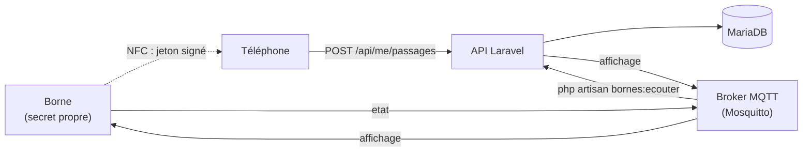

# Protocole des bornes

Ce document est le contrat entre le code de la borne, l'app et l'API : le jeton que la borne donne au téléphone, la façon dont il est écrit dans le tag NFC, et les messages MQTT échangés avec le serveur (BOR-03, BCK-04, R5.04).



## Le passage, en résumé

1. Le joueur approche son téléphone de la borne.
2. Le téléphone lit dans le tag NFC de la borne un **jeton**, calculé avec l'identifiant de la borne, l'heure et son secret, sous la forme d'une adresse web qui ouvre l'app. Quand le téléphone repart, la borne écrit un nouveau jeton.
3. Le téléphone envoie le jeton à l'API (`POST /api/me/passages`, voir [api/bornes.md](api/bornes.md)). Sans réseau, il le garde et l'envoie dans les 24 h.
4. L'API retrouve la borne grâce au jeton, vérifie la signature avec le secret de cette borne, vérifie l'heure, et refuse un jeton déjà utilisé.
5. L'API répond au téléphone, et publie le résultat sur le topic `affichage` de la borne, qui l'affiche à l'écran.

## Le jeton

Chaque borne a un **code** (son identifiant, de 3 à 16 caractères parmi les minuscules, les chiffres et les tirets) et un **secret**, donné une seule fois par `php artisan bornes:creer` et à enregistrer dans la borne. Le serveur garde le secret chiffré en base.

Format : `{code}.{heure}.{signature}`, en ASCII, 40 caractères au plus.

| Partie | Contenu |
| ------ | ------- |
| `code` | le code de la borne, par exemple `chateau-01` |
| `heure` | l'heure du scan en secondes Unix (UTC), écrite en base 36, minuscules. C'est en fait l'heure à laquelle la borne a écrit le jeton dans le tag, au plus 5 minutes avant la lecture (voir [Quand la borne écrit le jeton](#quand-la-borne-écrit-le-jeton)) |
| `signature` | HMAC-SHA256 de `{code}.{heure}` avec le secret de la borne comme clé, dont on garde les **12 premiers octets**, encodés en base64 URL sans `=` (16 caractères) |

Exemple, pour la borne `chateau-01` à 2026-10-13 13:00:00 UTC (`1791896400`, soit `tmuk40` en base 36) : `chateau-01.tmuk40.` suivi des 16 caractères de signature.

Règles appliquées par le serveur :

- la signature doit correspondre au secret de la borne nommée dans le jeton ;
- l'heure du scan doit dater de moins de 24 h et ne pas dépasser l'heure du serveur de plus de 5 minutes : **la borne doit être à l'heure (NTP)** ;
- un jeton ne sert qu'**une fois** : le serveur garde son empreinte (SHA-256) et refuse le même jeton ensuite, même présenté par un autre joueur. La borne écrit donc un nouveau jeton après chaque lecture.

`php artisan bornes:simuler {code}` affiche un jeton calculé exactement comme le ferait la borne, ce qui permet de tester l'app et l'API sans matériel.

### Jetons de référence

Le firmware (`scubatana.borne/lib/token`) et l'API (`TerminalTokenService`) sont testés avec les mêmes jetons. Une modification du calcul qui change l'un de ces jetons casse les deux suites de tests.

| Code | Secret | Heure du scan | Jeton |
| ---- | ------ | ------------- | ----- |
| `chateau-01` | `secret-de-test-scubanion` | `1791896400` (2026-10-13 13:00:00 UTC) | `chateau-01.tmuk40.uDW6vj4R1gI5gVbx` |
| `musee-02` | `un-autre-secret` | `1791896461` | `musee-02.tmuk5p.hZhp5q5RKaRZW-9C` |

Le secret sert de clé HMAC tel quel, sous forme de texte : la borne ne le décode pas.

## Le contenu du tag NFC

Le tag contient un message NDEF d'un seul enregistrement, de type adresse web (URI) :

```
https://scuba.picsou06.fr/b/{jeton}
```

Par exemple `https://scuba.picsou06.fr/b/chateau-01.tmuk40.` suivi des 16 caractères de signature.

- Les caractères du jeton (lettres, chiffres, `-`, `_` et `.`) passent tels quels dans une adresse, sans encodage.
- Le tout fait moins de 80 octets, en-têtes compris : la zone 1 de la puce suffit largement.
- Le domaine est un réglage du firmware, comme le Wi-Fi. L'app doit reconnaître celui qu'utilisent les bornes.
- Le téléphone ne fait que lire : la puce refuse toute écriture en NFC (voir [Protéger la puce NFC](borne-materiel.md#protéger-la-puce-nfc)).

**Pourquoi une adresse et pas un simple texte.** Android ouvre directement une app qui déclare l'adresse lue :

- l'app filtre l'intent `android.nfc.action.NDEF_DISCOVERED` sur `https://scuba.picsou06.fr/b/`. Le joueur approche son téléphone et l'app s'ouvre sur le passage, même si elle était fermée. Avec un enregistrement texte, Android afficherait « Nouveau tag NFC » ou un choix d'appli ;
- quand l'app est déjà au premier plan, elle lit le tag elle-même (*foreground dispatch* ou *reader mode*), pour ne pas être relancée.

Pas d'enregistrement *Android Application Record* (AAR) pour l'instant : il enverrait un téléphone sans l'app vers le Play Store, où Scubanion n'est pas publiée. À ajouter le jour où elle l'est.

## Quand la borne écrit le jeton

Le téléphone lit le tag dès qu'il entre dans le champ NFC, en quelques millisecondes : la borne n'a pas le temps de réagir à son arrivée, et la puce refuse les accès I2C pendant qu'elle répond au téléphone. La borne garde donc **toujours un jeton prêt** dans le tag. Elle détecte l'arrivée et le départ du téléphone grâce à la broche GPO de la puce (voir [borne-materiel.md](borne-materiel.md#nfc--un-tag-dynamique-pas-un-lecteur)).

| Moment | Ce que fait la borne |
| ------ | -------------------- |
| Au démarrage, dès qu'elle a l'heure (horloge ou NTP) | écrit un premier jeton |
| Un téléphone arrive (`FIELD_RISING`) | lance l'animation de l'anneau, sans rien écrire |
| Le téléphone repart (`FIELD_FALLING`) | écrit un nouveau jeton : celui qui vient d'être lu ne servira plus |
| 5 minutes sans scan | écrit un nouveau jeton, pour que son heure reste proche de celle de la lecture |

Conséquences :

- l'`heure` du jeton est celle de son écriture, au plus 5 minutes avant la lecture. Un passage juste après minuit peut donc compter pour la veille ;
- si deux téléphones lisent la borne l'un après l'autre sans que le premier soit reparti, ils lisent le même jeton : le second reçoit « déjà utilisé » et doit scanner à nouveau ;
- la borne n'écrit pas plus souvent : chaque bloc de la mémoire de la puce supporte un nombre limité d'écritures, de l'ordre du million d'après la fiche technique (à revérifier). Une écriture toutes les 5 minutes, plus une par scan, tient des années ; une toutes les 10 secondes userait la puce en quelques mois.

## Topics MQTT

Préfixe : `scubanion/bornes/{code}/`. L'API ignore les bornes non déclarées.

| Topic | Sens | QoS | Contenu |
| ----- | ---- | --- | ------- |
| `scubanion/bornes/{code}/etat` | borne vers serveur | 1, message retenu | signal de vie, et testament de la borne |
| `scubanion/bornes/{code}/affichage` | serveur vers borne | 1 | ce que l'écran doit montrer après un passage |

Tous les messages sont en JSON, encodé en UTF-8.

### Signal de vie (`etat`)

```json
{ "status": "online", "firmware": "1.0.0" }
```

- La borne publie `online` à sa connexion, puis toutes les 30 secondes, en message retenu.
- Elle déclare à la connexion un testament sur le même topic : `{ "status": "offline" }`, retenu. Le broker le publie si elle disparaît sans se déconnecter proprement.
- L'API considère une borne hors ligne après 120 secondes sans signal.

### Affichage (`affichage`)

Publié par l'API dès qu'un passage est enregistré :

```json
{ "scanned_at": "2026-10-13T15:00:00+02:00", "status": "rewarded", "message": "Bravo Lea ! +100 XP", "reward_xp": 100 }
```

| `status` | Quand | `message` |
| -------- | ----- | --------- |
| `rewarded` | premier passage du joueur à cette borne ce jour-là | « Bravo {pseudo} ! +100 XP » |
| `already_rewarded` | le joueur est déjà passé ce jour-là : le passage est enregistré, sans récompense | « Ton passage du jour est déjà compté, {pseudo}. Reviens demain ! » |

`scanned_at` reprend l'heure du jeton : la borne sait ainsi à quel scan correspond la réponse. Un jeton refusé (faux, expiré ou déjà utilisé) ne produit pas d'affichage : seul le téléphone reçoit l'erreur. Si le téléphone envoie le jeton plus tard (hors ligne), l'affichage arrive plus tard aussi ; la borne l'ignore si son `scanned_at` a plus de 10 minutes (le jeton est écrit au plus 5 minutes avant le scan).

## Connexion au broker

Le broker refuse les connexions sans compte. Il y a un compte pour l'API et un par borne.

| Compte | Nom d'utilisateur | Mot de passe |
| ------ | ----------------- | ------------ |
| API | `MQTT_USERNAME` (`scubanion.api` par défaut) | `MQTT_PASSWORD` |
| Borne | son code, par exemple `chateau-01` | HMAC-SHA256 du texte `mqtt` avec le secret de la borne comme clé, encodé en base64 URL sans `=` (43 caractères) |

Le mot de passe d'une borne est **dérivé de son secret** : il n'y a rien de plus à enregistrer dans la borne, et le secret qui signe les jetons ne passe jamais sur le réseau. Quelqu'un qui intercepterait le mot de passe MQTT ne pourrait pas en déduire le secret, donc pas fabriquer de jetons. Pour le secret `secret-de-test-scubanion` des [jetons de référence](#jetons-de-référence), le mot de passe vaut `eq27dNBa_0w-n0P9aCVmWRopOfEXQWMvMNDfz7MS-dc` : le firmware (`token::mqttPassword`) et l'API (`TerminalTokenService::mqttPassword`) sont testés avec cette valeur.

Le nom du compte de l'API contient un point, qu'un code de borne ne peut pas contenir : une borne ne peut pas prendre le nom de l'API.

**Droits.** Chaque compte ne touche qu'à ce dont il a besoin :

| Compte | Peut publier sur | Peut lire |
| ------ | ---------------- | --------- |
| API | tous les topics `scubanion/bornes/…` | tous les topics `scubanion/bornes/…`, et `$SYS/…` pour le healthcheck du broker |
| Borne `{code}` | `scubanion/bornes/{code}/etat` | `scubanion/bornes/{code}/affichage` |

Une borne ne peut donc ni se faire passer pour une autre, ni lire l'affichage d'une autre borne (qui contient le pseudo des joueurs), ni écrire sur son propre écran.

**Où sont les comptes.** L'API écrit les fichiers `passwd` (mots de passe hachés au format de `mosquitto_passwd`) et `acl` (droits) dans `storage/app/mqtt`, que le broker lit dans `/mosquitto/comptes`. En prod, c'est le volume `mqtt_comptes`, partagé entre `backend` et `mosquitto`.

- Le conteneur `backend` les écrit à chaque démarrage (`php artisan bornes:comptes-mqtt`), avant que le broker ne démarre.
- `php artisan bornes:creer` ajoute aussitôt le compte de la nouvelle borne. Le broker ne relit ses fichiers que sur demande : `docker compose kill -s HUP mosquitto`, sans redémarrage ni coupure.

**Limite connue.** Le port 1883 n'est pas chiffré : quelqu'un sur le même réseau que la borne peut lire son mot de passe MQTT et se faire passer pour elle (faux signaux de vie, lecture de son affichage). Le secret des jetons, lui, reste protégé. La suite est de passer en TLS (port 8883), que l'ESP32 sait gérer.

## Côté borne

Le firmware (`scubatana.borne`) se connecte au broker `MQTT_HOST:MQTT_PORT` de `include/borne_config.h`, avec son code comme identifiant de client et comme nom d'utilisateur.

- **Session persistante** (`clean session` à faux) et abonnement en QoS 1 à `affichage` : un affichage publié pendant une courte coupure arrive à la reconnexion, et la règle des 10 minutes écarte ceux qui sont trop vieux.
- **Keep alive de 15 secondes** : le broker publie le testament environ 20 secondes après une coupure franche (borne débranchée, Wi-Fi perdu).
- **Reconnexion** toutes les 5 secondes tant que le broker ne répond pas. Le jeton continue d'être écrit, mais une tentative vers une adresse injoignable bloque la boucle quelques secondes : à revoir avec la détection du téléphone par la broche GPO.
- **Écran** : l'accueil montre le logo de l'app qui flotte doucement (±6 px, un aller-retour en 3,6 s), « Pose ton téléphone sur le cercle », et en bas à gauche une pastille verte ou rouge selon la connexion au broker, pour l'équipe. Un affichage reçu reste 8 secondes : fond vert et titre « Bien joué ! » pour `rewarded`, fond orange pour `already_rewarded`, avec le `message` de l'API coupé en lignes. Il est aussi écrit sur le port série.
- **Repos de l'écran** (sobriété, R5.13) : 2 minutes sans passage (et 2 minutes après l'allumage), le rétroéclairage descend à environ 10 % (PWM `ledc` sur IO21) et le logo s'immobilise ; l'accueil reste lisible. Un affichage reçu rallume l'écran à fond. Quand la détection du téléphone par la broche GPO sera en place, elle le réveillera aussi.

L'écran est une dalle ST7789 (identifiant `81 81 B3`) pilotée par Adafruit ST7789, sans inversion des couleurs, et le texte passe par U8g2 pour les accents. Ses broches sont dans `src/screen.cpp`. Le logo est une image RGB565 dans `src/logo.h`, générée par `tools/logo.py` depuis `scubatana.frontend/public/img/logo.png`.

Le code testable est dans `lib/messages` (topics, messages JSON, lecture de `scanned_at`) et `lib/text` (coupure du message en lignes), testé par `pio test -e native`.

## Côté serveur

| Commande | Rôle |
| -------- | ---- |
| `php artisan bornes:creer chateau-01 "Borne du Château" --lieu=3` | déclare une borne, rattachée à un lieu, affiche son secret une seule fois et ajoute son compte MQTT |
| `php artisan bornes:comptes-mqtt` | réécrit les comptes et les droits du broker (voir [Connexion au broker](#connexion-au-broker)) |
| `php artisan bornes:ecouter` | écoute les signaux de vie des bornes. Processus permanent : un conteneur ou un service dédié en prod |
| `php artisan bornes:simuler chateau-01` | joue le rôle de la borne : affiche le jeton qu'elle donnerait au téléphone, puis attend et affiche la réponse publiée sur `affichage` |
| `php artisan bornes:simuler chateau-01 --etat=online` | envoie un signal de vie |

### Mettre une borne en service

1. Déclarer la borne : `docker compose exec backend php artisan bornes:creer chateau-01 "Borne du Château" --lieu=3`, et noter le secret affiché.
2. Faire relire les comptes au broker : `docker compose kill -s HUP mosquitto`. Sans ça, la borne est refusée par le broker jusqu'au prochain redémarrage de `mosquitto`.
3. Mettre le code, le secret et l'adresse du broker (`MQTT_HOST`) dans `include/borne_config.h` du firmware, puis flasher la borne.
4. Vérifier que la borne passe en ligne : `online` à `true` dans `GET /api/bornes`.

Réglages (`config/bornes.php`, variables d'environnement) : `MQTT_HOST` (le nom du service du broker, `mosquitto` par défaut, jamais une IP), `MQTT_PORT`, `MQTT_USERNAME`, `MQTT_PASSWORD`, `MQTT_CLIENT_ID`, `MQTT_ACCOUNTS_DIRECTORY` (`storage/app/mqtt`), `BORNE_REWARD_XP` (100), `BORNE_MAX_REPLAY_HOURS` (24), `BORNE_FUTURE_TOLERANCE_MINUTES` (5), `BORNE_TOKEN_REFRESH_MINUTES` (5), `BORNE_MAX_TRAVEL_SPEED_KMH` (150). Les deux derniers servent à vérifier que le joueur était à la borne (voir les [règles du jeu](regles-du-jeu.md#bornes)).

L'affichage est publié après l'envoi de la réponse au téléphone : un broker injoignable ne bloque pas le passage, il est seulement noté dans les journaux.

Tests : le jeton et le mot de passe MQTT dans `tests/Unit/Services/TerminalTokenServiceTest.php`, les comptes du broker dans `tests/Unit/Services/MqttAccountsTest.php`, les passages dans `tests/Feature/Bornes/PassageTest.php`, l'écoute MQTT (client remplacé par un mock) dans `tests/Feature/Bornes/BorneListenerTest.php`.
