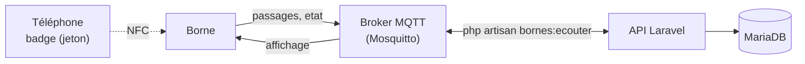

# Protocole MQTT des bornes

Les bornes et le serveur échangent par MQTT (BOR-03, BCK-04), comme demandé en R5.04. Ce document est le contrat entre le code de la borne et l'API : topics, messages, garanties.



## Pourquoi MQTT

- **Léger** : un microcontrôleur (ESP32) tient une connexion MQTT sans effort, avec très peu de trafic.
- **Publication et abonnement** : la borne ne connaît que le broker, jamais l'adresse de l'API. On peut ajouter une borne, ou un second consommateur (monitoring, Kafka si D5 le retient), sans toucher aux autres.
- **Qualité de service** : la QoS 1 garantit qu'un passage arrive au moins une fois, même après une coupure.
- **Testament (*Last Will*)** : le broker annonce lui-même qu'une borne a disparu, ce qui sert au signal de vie (BOR-08).

## Topics

Préfixe : `scubanion/bornes/{code}/`, où `{code}` est l'identifiant de la borne déclaré avec `php artisan bornes:creer` (minuscules, chiffres, tirets). L'API ignore les bornes non déclarées.

| Topic | Sens | QoS | Contenu |
| ----- | ---- | --- | ------- |
| `scubanion/bornes/{code}/passages` | borne vers serveur | 1 | un joueur a badgé |
| `scubanion/bornes/{code}/affichage` | serveur vers borne | 1 | ce que l'écran doit montrer après un passage |
| `scubanion/bornes/{code}/etat` | borne vers serveur | 1, message retenu | signal de vie, et testament de la borne |

## Messages

Tous les messages sont en JSON, encodé en UTF-8.

### Passage (`passages`)

```json
{ "id": "6f1c2a9e-3b7d-4f0a-9c55-2e8b1d4a7c10", "token": "7.mhq4xk.Qm9uam91ciBMw6lh", "scanned_at": "2026-10-13T15:00:00+02:00" }
```

| Champ | Rôle |
| ----- | ---- |
| `id` | identifiant du passage, tiré au hasard par la borne (UUID conseillé, 64 caractères au plus). Il rend l'envoi idempotent : un même `id` renvoyé ne compte qu'une fois. |
| `token` | le badge lu sur le téléphone, transmis tel quel. La borne ne le vérifie pas. |
| `scanned_at` | date et heure du badge, au format ISO 8601 avec fuseau. La borne doit avoir son horloge à l'heure (NTP). |

### Affichage (`affichage`)

La réponse de l'API, à afficher sur l'écran de la borne :

```json
{ "passage": "6f1c2a9e-3b7d-4f0a-9c55-2e8b1d4a7c10", "status": "rewarded", "message": "Bravo Lea ! +100 XP", "reward_xp": 100 }
```

| `status` | Quand | `message` |
| -------- | ----- | --------- |
| `rewarded` | premier passage du joueur à cette borne aujourd'hui | « Bravo {pseudo} ! +100 XP » |
| `already_rewarded` | le joueur est déjà passé aujourd'hui : le passage est enregistré, sans récompense | « Déjà passé aujourd'hui, {pseudo}. Reviens demain ! » |
| `invalid_token` | badge inconnu, falsifié ou expiré au moment du badge | « Badge non reconnu. » |
| `invalid_message` | message illisible, champ manquant, ou `scanned_at` trop vieux (plus de 24 h) ou dans le futur | « Passage illisible, réessaie. » |

`passage` reprend l'`id` du passage, pour que la borne sache à quel badge correspond la réponse. Le `message` est prêt à afficher : la borne n'a rien à traduire.

### Signal de vie (`etat`)

```json
{ "status": "online", "firmware": "1.0.0" }
```

- La borne publie `online` à sa connexion, puis toutes les 30 secondes, en message retenu.
- Elle déclare à la connexion un testament sur le même topic : `{ "status": "offline" }`, retenu. Le broker le publie si elle disparaît sans se déconnecter proprement.
- L'API considère une borne hors ligne après 120 secondes sans signal. Un passage compte aussi comme signe de vie.

## Le badge

Le téléphone obtient son badge par `GET /api/me/badge` (voir [api/bornes.md](api/bornes.md)) et le transmet à la borne par NFC. Le moyen exact (émulation de carte, ou autre) dépend de la décision D2 : le badge est le même dans tous les cas.

- Format : `{joueur}.{expiration}.{signature}`, environ 25 caractères ASCII. Le joueur et l'expiration sont écrits en base 36, la signature est un HMAC-SHA256 tronqué, calculé avec la clé de l'application.
- Durée de vie : 5 minutes. Il ne révèle que l'identifiant interne du joueur, jamais son email ni son pseudo, et ne peut pas être fabriqué sans la clé du serveur (BOR-02).
- La validité se juge à l'heure du badge (`scanned_at`), pas à l'heure de réception : un passage gardé hors ligne reste valable.

## Hors ligne

- **Côté borne (BOR-09)** : sans réseau, la borne garde ses passages, avec leur `id` et leur `scanned_at`, puis les renvoie à la reconnexion. L'API les accepte jusqu'à 24 heures après le badge, n'en compte chaque `id` qu'une fois, et répond pour chacun sur `affichage`.
- **Côté serveur** : l'API se connecte au broker avec un identifiant fixe et une session persistante. Si elle redémarre, le broker lui livre à son retour les passages arrivés pendant son absence. C'est vérifié avec un vrai Mosquitto : un passage envoyé pendant que l'API était arrêtée a été traité dès son redémarrage.

## Côté serveur

| Commande | Rôle |
| -------- | ---- |
| `php artisan bornes:creer chateau-01 "Borne du Château" --lieu=3` | déclare une borne, rattachée à un lieu |
| `php artisan bornes:ecouter` | écoute les bornes, traite les passages et répond. Processus permanent : un conteneur ou un service dédié en prod |
| `php artisan bornes:simuler chateau-01 --joueur=1` | joue le rôle d'une borne : envoie un passage pour le joueur 1 et affiche la réponse de l'API |
| `php artisan bornes:simuler chateau-01 --etat=online` | envoie un signal de vie |

Réglages (`config/bornes.php`, variables d'environnement) : `MQTT_HOST` (le nom du service du broker, `mosquitto` par défaut, jamais une IP), `MQTT_PORT`, `MQTT_USERNAME`, `MQTT_PASSWORD`, `MQTT_CLIENT_ID`. Le broker lui-même (conteneur, comptes, droits par borne) relève de la partie borne.

Le traitement est testé sans broker : le client MQTT est remplacé par un mock dans `tests/Feature/Bornes/BorneListenerTest.php`, et les règles des passages sont testées dans `PassageTest.php`.
